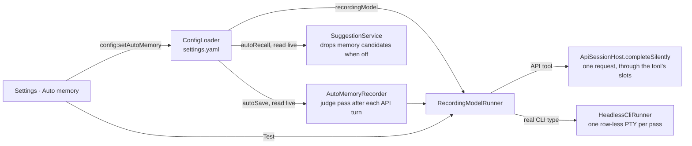
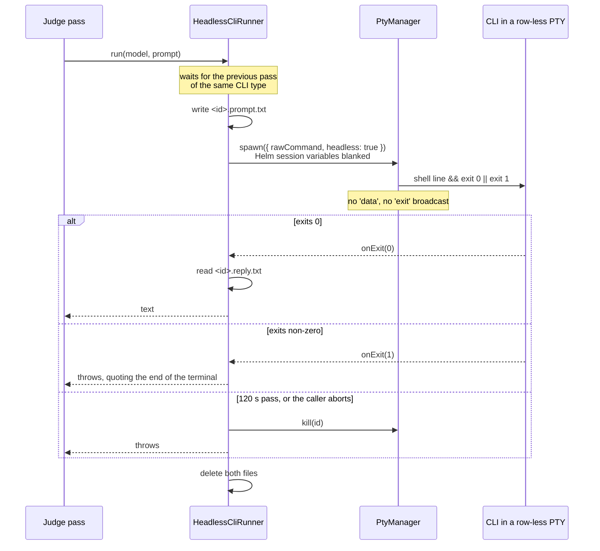
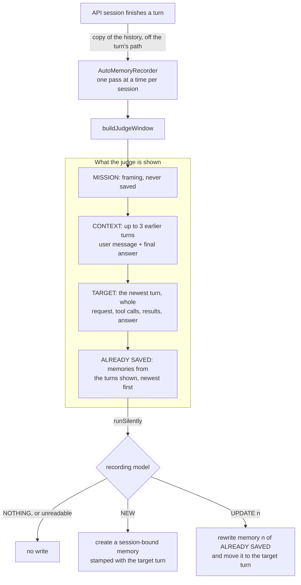
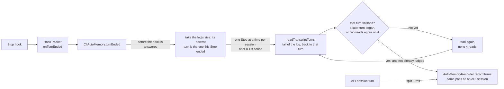
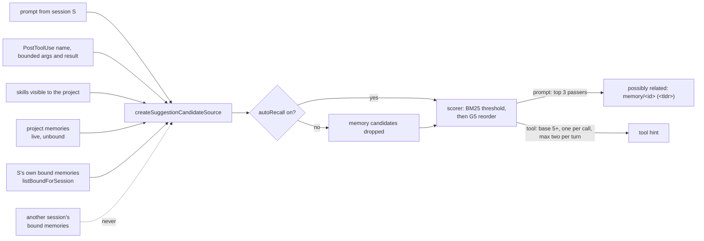

# Auto memory

Helm records the key facts of every session as memories and recalls them later, without the working model spending tokens on it. This document covers the parts that have shipped: the settings, the silent runner, auto-save for API sessions and for real CLI sessions, recall of what a session saved, and the dream that turns saved memories into project knowledge ([dreaming.md](dreaming.md#digesting-session-bound-memories)). The storage rules for the memories themselves are in [memory.md](memory.md).

## Settings

Settings → **Auto memory** holds one global setting, stored as `autoMemory` in `settings.yaml` under the user config dir.

| Field | Default | Meaning |
|---|---|---|
| `recordingModel` | none | CLI type id of the model that does the recording. |
| `autoSave` | on | Run the judge pass after each turn. With no model picked it does nothing, and the tab says so. |
| `autoRecall` | on | Let the suggester hint at memories. Skill hints are unaffected. |
| `judgePrompt` | empty | The judge's system prompt. The tab shows the default text to edit in place; empty (or text equal to the default) stores nothing, so a later change to the default still reaches you. **Reset to default** clears it. Read live by the recorder. |

Suggestion learning is a separate section on this page. It learns from both
memory and skill fetches, stores feedback by project, and only adjusts ranking
inside that project. Each learned skill or memory appears once, with the
projects where it was learned listed in its detail. Selecting an item shows its
skill or memory text read-only when it still exists. The fixed-height
master/detail keeps the item list and detail independently scrollable instead
of letting long text grow the Settings page. Project filters change the report;
**All projects** does not combine project rankings. Existing unscoped feedback
remains visible as Unattributed legacy and is excluded from scoring. See
[CLI hooks](cli-hooks.md) for the correlation window and privacy boundary.

- **One global model**, not one per project or per CLI type.
- **The picker lists Helm's configured CLI types.** API tools are pickable. A real CLI type (Claude Code, Codex, …) is pickable when it has a [headless command](#real-clis-the-headless-run), and is marked "real CLI: its full prompt on every turn". One without is listed disabled as "no headless command". ComfyUI types are not listed: they have no text model.
- **The tab states the price of a real CLI before one is picked.** Picking saves at once, so the note stands above the pick whenever the list offers a real CLI: it is started once per pass, loads its whole system prompt each time (about 28k tokens for Claude Code), runs after every turn of every session, and on the same provider draws on the quota of the sessions it serves.
- **A model that cannot record is refused, not stored.** `ConfigLoader.setAutoMemoryConfig` throws for a real CLI type with no usable headless command, a ComfyUI type or an unknown reference, and the tab shows the reason. A pick that quietly records nothing would be worse than an error.
- **A stored pick that stops being runnable** (its CLI type deleted, its `api` block removed, or its headless command gone) is flagged in the tab and Test is disabled; silent runs answer `failed`.
- **An API tool without a base URL or a model** is listed disabled as "API settings are incomplete" and refused.
- **Test** sends one small request to the picked model and reports whether it answered.

## Silent runs

The judge never opens a session. It asks `SilentRunner.runSilently({ prompt, system? })` (`src/session/silent-model-runner.ts`) and reads the outcome:

| Result | When |
|---|---|
| `{ status: 'ok', text }` | The model answered. |
| `{ status: 'inert', reason }` | No recording model is picked. No request was made. |
| `{ status: 'failed', error }` | The request failed, the model returned no text, the picked type was deleted, or its headless run failed, timed out or has no command. |

`runSilently` never throws, and a failure never reaches the user's chat: it is logged and returned. Every judge pass that asked the model leaves one log line, `[AutoMemory] Judge pass for <session>: nothing | created | updated | failed`, so a pass with nothing to keep cannot be mistaken for one that never ran; a turn too big for the window is logged as not judged.

Callers depend on the interface only. Behind it, `RecordingModelRunner` resolves the picked CLI type and hands the request to the backend for its kind:

- **API tool**: `ApiSessionHost.completeSilently` sends one chat-completions request with no tools offered. It waits for one of that API tool's `slots`, the same queue its sessions and subagents use, so a judge pass queues behind real work instead of competing with it. Aborting the request while it is still queued gives its place up at once. No `PtyProcess`, no session row, no history file, no chat entry, no hook event.
- **Real CLI type**: `HeadlessCliRunner` runs the CLI once, headless, in a row-less PTY. See below.

### Real CLIs: the headless run

A real CLI has no request path: Helm only knows how to start it. `HeadlessCliRunner` (`src/session/headless-cli-runner.ts`) starts it once per pass with the type's **headless command**, a shell line that reads the prompt from one file and leaves the reply in another:

| CLI family | Suggested headless command |
|---|---|
| Claude Code | `claude -p --no-session-persistence --strict-mcp-config --output-format text --tools "" < "{promptFile}" > "{outputFile}"` |
| Codex | `codex exec --skip-git-repo-check --ephemeral --sandbox read-only -o "{outputFile}" - < "{promptFile}"` |
| Copilot | none: its print mode only takes the prompt as an argument |

**A CLI type runs headless only with the command saved on it** (Tool Editor → Launch → Headless Command, `headlessCommand` in `cli-types.yaml`). Nothing is assumed from the type's family: one without a command is listed as "no headless command" and cannot be picked, so the line a pass runs is always one you can see and change. The table is what Helm *suggests* (`SUGGESTED_HEADLESS_COMMANDS` in `src/session/headless-command.ts`): the Tool Editor puts it in the field of a Claude Code or Codex type that has none, where it takes effect once the tool is saved; the shipped `cli-types.yaml` carries it for a fresh install; and the field's tooltip shows one as an example. A type set up before the field existed has none until its editor is opened and saved. Change the line to name a cheaper model, to keep a profile, or to give a CLI of another family a command. A command without both `{promptFile}` and `{outputFile}` is refused.

Files, not arguments or the terminal: a prompt is many lines of anything and no shell quotes that reliably, and a reply scraped from a terminal carries the shell's echo and its colour codes. The placeholders are filled with bare file names in the run's working directory, never full paths: a `%`, `$` or backtick in one of the user's directory names would be code in a shell line.

**The judged transcript is untrusted text handed to an agent**, and a tool result in it can try to give that agent orders. The suggested commands take its hands away: Claude Code runs with no tools (`--tools ""`) and no MCP servers, so it can only answer. Codex cannot switch its shell off, so it runs in its read-only sandbox: it can read files and say what it read, it cannot change anything. A `headlessCommand` of your own carries whatever limits you give it, and none if you give none.

- **It is a PTY, so invariant 2 holds as written.** The CLI runs in an embedded PTY inside `PtyManager` and its command reaches it through PTY stdin. `PtyManager` tracks the process, and kills it with every other one when the app quits.
- **It is not a session.** `spawn({ headless: true })` never emits `data` or `exit` for the run. Everything that makes a PTY a session hangs off those two events: the renderer's terminal, the state detector, the pattern matcher, the Telegram mirror, the session record, the recycle bin, time tracking. The runner listens on the process it was handed instead.
- **No hook reaches Helm, so a judge pass cannot start a judge pass.** The CLI's hooks are installed machine-wide and do fire in a headless run. The shim does nothing without `HELM_SESSION_ID`, and the runner blanks it, with the hook URL and the token, in the run's environment. That also covers a Helm that was itself started from inside a Helm session and inherited those variables, and a type whose own `env` sets them.
- **One pass at a time per CLI type.** Passes of the same type queue, since a second CLI process would only race the first for the same quota. Different types do not wait for each other. A failed pass does not block the queue.
- **A pass is bounded.** After 120 s the PTY is killed and the pass dropped. An abort does the same at once.
- **The run's directory is Helm's own temp dir** (`<temp>/headless`), not a project: a CLI that does keep a transcript does not file it under the project it is judging.
- **It still reads the user's own CLI configuration** (for Claude Code, the global `CLAUDE.md`). An instruction there that shapes every reply shapes the judge's too, and the reply is parsed strictly, so such a pass may save nothing.
- **An abort while queued** drops the pass at once; the passes behind it keep their place. An abort while the prompt file is being written is honoured before anything is started.

## Auto-save: the judge pass

After each finished turn of an API session, Helm asks the recording model whether the conversation now holds a key memory. It identifies, it does not summarise: most turns save nothing, and that is the correct answer.

The default prompt names work status as never-save: commit hashes, plan ids, test counts, "committed / approved / queued" reports, task scope and next steps, and UI changes just built. Git, plans and todos already hold those; saving them filled memory with stale progress logs. The bar for NEW is that a different session a month later would act differently because of it.

- **When it runs.** Every completed turn of a top-level API session, tool-using or not, when Auto-save is on and a recording model is picked. A failed or interrupted turn is skipped. So is a subagent: its result is already filed as a memory for its parent.
- **What a turn is.** A submitted request (the user message carrying Helm's per-turn `<helm_context>`) and everything up to the next one. A message the user adds while the turn runs, or a rollback note, stays inside that turn and is shown in TARGET.
- **A closed session writes nothing.** A pass checks that its session still exists before it starts and again before it writes, so a slow judge cannot leave a memory behind for a session that is gone.
- **Per-tool opt-out.** `api.autoMemory: false` in a CLI type's `api` block keeps every session of that API tool out (see [api-tools.md](api-tools.md)).
- **The session is never touched.** The pass reads a copy of the history after the turn has ended. It adds no history entry, no chat message, no terminal output and no hook event; the history file is byte-identical with Auto-save on or off. A failed pass is logged and dropped.
- **One memory at most per pass**, always session-bound: only its own session sees it until a dream digests it.
- **The memory comes from the whole window.** The question may sit in one turn, the clue in the next, the result in the target. The target is the newest piece, not the only source.
- **Duplicates are prevented by showing what is saved.** Windows overlap, so the same fact is in front of up to four passes. Each memory records its source turn (`sourceTurn`, a hash of that turn's user message), and a pass lists the memories whose source turn is in its window. The list slides with the window and needs no cap. An update moves the memory to the turn that completed it. Passes over one session run one at a time, so each sees what the one before saved.
- **Budget.** The window is capped at about 3000 tokens (`JUDGE_WINDOW_TOKENS`, estimated at four characters a token). Over budget, tool results shrink first, then the oldest context turn is dropped, then the oldest half of the target's steps (again and again, with a line saying how many are not shown), then the target's own text is clipped. The mission is never dropped. A long agent turn of a real CLI, with hundreds of tool calls, is therefore judged on its request, its last steps and its answer.
- **Strict reply format.** `NOTHING`, or `NEW` / `UPDATE <n>` followed by a `TLDR:` line and a `CONTENT:` line. Thinking blocks and code fences are tolerated; anything else, including a chatty lead-in or an `UPDATE` naming a memory not in the list, saves nothing. The tldr is cut at 200 characters and the content at 600.
- **The tldr is written for the suggester**: the fact itself, with the terms someone would search for ("RS485 on the EG004 needs 9600 baud", not "Baud rate finding").

All of it lives in `src/session/auto-memory-judge.ts`; `ApiSessionHost` only hands over the finished turn.

### CLI sessions

A real CLI (Claude Code, Codex, Copilot CLI) gets the same pass. Helm does not own its loop, so the turns are read back from the log the CLI's hooks report, the file Quick Compact strips ([quick-compact-switch-cli.md](quick-compact-switch-cli.md)). Only the source of the turns differs: the window, the prompt, the parser and the recorder are the ones above.

- **Trigger.** The `Stop` hook, so a session without hooks installed is never recorded: it has no transcript path. A sub-agent's `SubagentStop` and a failed turn's `StopFailure` do not trigger it.
- **What a turn is.** A user message and everything up to the next one. Text a CLI or a hook puts under the user role does not start a turn: meta and compact-summary records, slash-command wrappers, environment and instruction blocks, Stop-hook feedback, task notifications, interrupt markers, keep-warm pings. Helm's own wrappers are stripped from a request with the transcript stripper's rules, so a phone message is judged as the text the user wrote.
- **Turn identity.** The id the CLI gave the user record (`uuid` for Claude Code, the message `id` for Codex, the event `id` for Copilot). Older Codex rollouts carry no message id; there the key is a hash of the record's timestamp and text. It does not depend on where the read started, so `sourceTurn` stays valid as the log grows.
- **Only the tail is read.** A pass needs four turns and a log can be hundreds of megabytes. The read starts at the last megabyte and grows fourfold until it holds four turns, the whole file, or 64 MB. A single turn larger than that is not judged.
- **Which turn a Stop ended.** The newest turn in the log at the moment the Stop arrives. The log's size is taken before the hook is answered, and the turn's key is read from the log up to that size, so a request sent the instant the hook returns cannot be mistaken for it. The pass itself runs later, and by then the next turn may be running, so the pass looks that turn up by key and takes it and the turns before it. The read goes back as far as that turn needs.
- **When a turn counts as finished.** The logs carry no end-of-turn record that holds across the three CLIs, the Stop hook can fire before the final message is written, and text an agent writes before a tool call looks like an answer. So the turn is finished once a later request exists, or once two reads a second apart show it unchanged. A pass therefore starts about two seconds after the Stop. After four reads without agreement the turn is given up, until its next Stop.
- **A repeated Stop is not judged twice.** Stops of one session are judged one at a time, and a Stop that adds nothing to the turn last judged makes no request. A turn that grew (a Stop-hook nudge made the agent continue) is judged again, with what it saved already listed under ALREADY SAVED. A pass that failed, or found auto-save off, leaves the turn for its next Stop.
- **Cost on the main process.** The read is asynchronous; parsing is not. The usual megabyte parses in a few milliseconds, the 64 MB worst case in about a quarter of a second.
- **A turn cut short is no context.** An earlier turn without an answer (interrupted) is left out of the window.
- **Not applicable to CLIs:** the per-tool `api.autoMemory` opt-out. Auto-save for CLI sessions is all or nothing.

| CLI | Supported | User request | Tool calls and results | Turn key |
|---|---|---|---|---|
| Claude Code | yes | `user` record with text and no `tool_result` | `tool_use` blocks, `tool_result` blocks | `uuid` |
| Codex | yes | `response_item` message, role `user` | `function_call` / `custom_tool_call` and their `_output` | message `id`, else a hash |
| Copilot CLI | yes | `user.message` (`content`, not `transformedContent`; not a sub-agent's, which has `parentAgentTaskId`) | `toolRequests`, `tool.execution_complete` | event `id` |
| Any other hooked CLI | no | falls through to the Claude reader and yields no turns | | |

Copilot sessions are recorded but cannot be hinted at ([Auto-recall](#auto-recall)): what they save reaches other sessions once a dream promotes it.

The adapter and the trigger live in `src/session/cli-auto-memory.ts`.

### What a pass costs

Measured on 2026-10-14 against the local llama router, one two-turn "nothing to keep" window and one window holding a fact, three runs each with a warm prompt cache:

| Model | Nothing to keep | Fact found | Prompt tokens |
|---|---|---|---|
| minicpm | 0.8 to 1.3 s, 80 to 120 completion tokens | 5 to 9 s, 600 to 1060 completion tokens | 715 to 807, about 600 cached |
| bonsai | 6 to 7 s, 185 to 240 completion tokens | about 11 s, about 400 completion tokens | 580 to 710, about 420 cached |

Both answered `NOTHING` and found the fact in all three runs. Nearly all completion tokens are the model's reasoning. A first request after a model load took 12 to 21 s.

A real CLI as the recording model, measured the same day with the suggested commands and a one-word reply: Claude Code about 6.7 s, Codex about 5.8 s, each one a fresh process carrying its whole agent prompt. Compare that with a second or so and under a thousand tokens for a small local model before picking one.

## Auto-recall

Recall uses the same hint suggester on prompts and completed CLI tool calls
([cli-hooks.md](cli-hooks.md), "The hint-only suggester"). Auto memory adds one
thing to its candidate list: the asking session's own bound memories. There is
no second recall path and no model in it.

- **Same line, same rules.** A bound memory is hinted as `memory/<id> (<tldr>)`
  like any other. Prompt hints use the 3.5 BM25 floor; tool hints use a
  stricter base-score floor of 5. An explicit name bypasses scoring. Each
  pointer is sent once per session until compaction or a clear/compact start
  resets the ledger. This is why the judge writes the tldr as the fact itself.
- **Own session only.** A session is reminded of what it learned earlier; other sessions of the project see the memory only after a dream releases its binding, at which point it arrives through the project list.
- **No project needed.** A session outside any project still gets its own bound memories as candidates.
- **Prompt and tool paths.** CLI prompt hints use UserPromptSubmit, or
  Copilot's `userPromptTransformed`; API sessions use `promptContext`. Claude
  Code, Codex, and Copilot also receive one PostToolUse pointer beside a
  completed tool result. Copilot still drops `userPromptSubmitted` output,
  but its PostToolUse response supports additional context. API sessions do
  not receive tool-result hints.
- **Bounded tool query.** The query includes the tool name, at most 800
  argument characters, and at most 1,200 result characters. Argument keys
  containing `secret`, `token`, `password`, or `credential` are excluded.
  Query text is not logged or used for suggestion-learning feedback. Tool
  results have a 50 ms budget; the hook stops waiting at 50 ms, sends no hint
  and records no no-repeat state. Object results are walked with a node budget
  before serializing, and their secret-named keys are dropped too.
- **The switch.** `SuggestionService` reads `autoRecall` on every prompt or tool hint. Off means memory candidates, bound or not, are dropped before scoring, so no memory is hinted; skills are still suggested. Switching it back on needs no restart.
