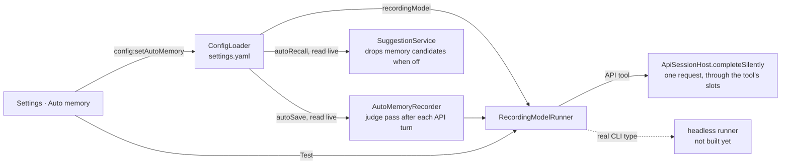
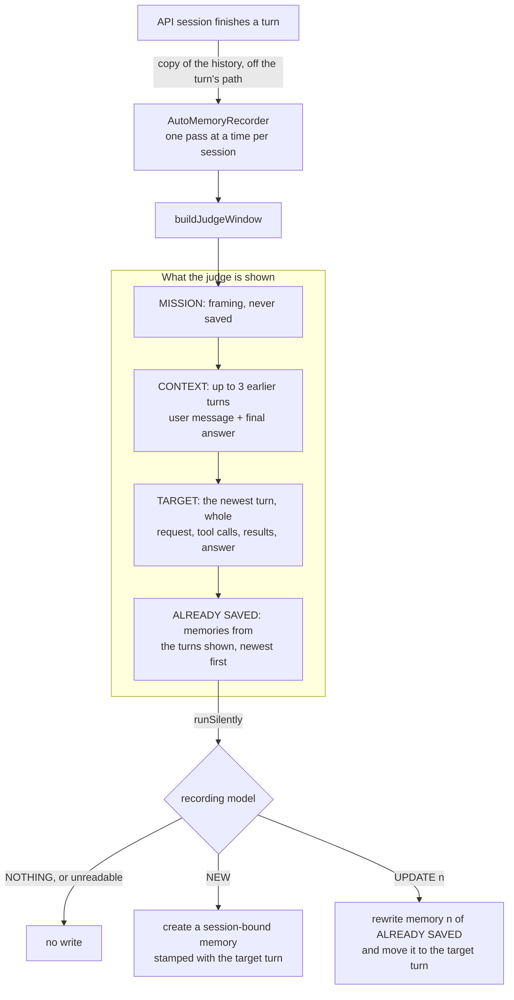
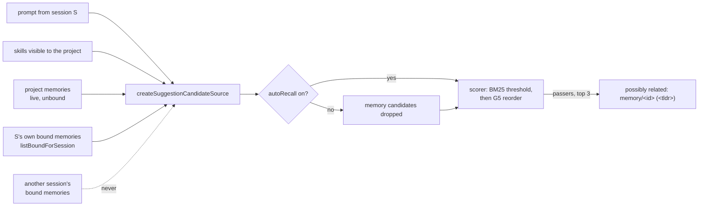

# Auto memory

Helm records the key facts of every session as memories and recalls them later, without the working model spending tokens on it. This document covers the parts that have shipped: the settings, the silent runner, auto-save for API sessions, recall of what a session saved, and the dream that turns saved memories into project knowledge ([dreaming.md](dreaming.md#digesting-session-bound-memories)). Real CLI sessions are not recorded yet. The storage rules for the memories themselves are in [memory.md](memory.md).

## Settings

Settings → **Auto memory** holds one global setting, stored as `autoMemory` in `settings.yaml` under the user config dir.

| Field | Default | Meaning |
|---|---|---|
| `recordingModel` | none | CLI type id of the model that does the recording. |
| `autoSave` | on | Run the judge pass after each turn. With no model picked it does nothing, and the tab says so. |
| `autoRecall` | on | Let the suggester hint at memories. Skill hints are unaffected. |

- **One global model**, not one per project or per CLI type.
- **The picker lists Helm's configured CLI types.** API tools are pickable. Real CLI types (Claude Code, Codex, …) are listed disabled with "needs headless runner" until that runner exists. ComfyUI types are not listed: they have no text model.
- **A model that cannot record is refused, not stored.** `ConfigLoader.setAutoMemoryConfig` throws for a real CLI type, a ComfyUI type or an unknown reference, and the tab shows the reason. A pick that quietly records nothing would be worse than an error.
- **A stored pick that stops being runnable** (its CLI type deleted, or its `api` block removed) is flagged in the tab and Test is disabled; silent runs answer `failed`.
- **An API tool without a base URL or a model** is listed disabled as "API settings are incomplete" and refused.
- **Test** sends one small request to the picked model and reports whether it answered.

## Silent runs

The judge never opens a session. It asks `SilentRunner.runSilently({ prompt, system? })` (`src/session/silent-model-runner.ts`) and reads the outcome:

| Result | When |
|---|---|
| `{ status: 'ok', text }` | The model answered. |
| `{ status: 'inert', reason }` | No recording model is picked. No request was made. |
| `{ status: 'failed', error }` | The request failed, the model returned no text, the picked type was deleted, or it is a real CLI type with no headless runner. |

`runSilently` never throws, and a failure never reaches the user's chat: it is logged and returned.

Callers depend on the interface only. Behind it, `RecordingModelRunner` resolves the picked CLI type and hands the request to the backend for its kind:

- **API tool**: `ApiSessionHost.completeSilently` sends one chat-completions request with no tools offered. It waits for one of that API tool's `slots`, the same queue its sessions and subagents use, so a judge pass queues behind real work instead of competing with it. Aborting the request while it is still queued gives its place up at once. No `PtyProcess`, no session row, no history file, no chat entry, no hook event.
- **Real CLI type**: no backend yet. The headless runner registers as the `cli` backend when it lands.

## Auto-save: the judge pass

After each finished turn of an API session, Helm asks the recording model whether the conversation now holds a key memory. It identifies, it does not summarise: most turns save nothing, and that is the correct answer.

- **When it runs.** Every completed turn of a top-level API session, tool-using or not, when Auto-save is on and a recording model is picked. A failed or interrupted turn is skipped. So is a subagent: its result is already filed as a memory for its parent.
- **What a turn is.** A submitted request (the user message carrying Helm's per-turn `<helm_context>`) and everything up to the next one. A message the user adds while the turn runs, or a rollback note, stays inside that turn and is shown in TARGET.
- **A closed session writes nothing.** A pass checks that its session still exists before it starts and again before it writes, so a slow judge cannot leave a memory behind for a session that is gone.
- **Per-tool opt-out.** `api.autoMemory: false` in a CLI type's `api` block keeps every session of that API tool out (see [api-tools.md](api-tools.md)).
- **The session is never touched.** The pass reads a copy of the history after the turn has ended. It adds no history entry, no chat message, no terminal output and no hook event; the history file is byte-identical with Auto-save on or off. A failed pass is logged and dropped.
- **One memory at most per pass**, always session-bound: only its own session sees it until a dream digests it.
- **The memory comes from the whole window.** The question may sit in one turn, the clue in the next, the result in the target. The target is the newest piece, not the only source.
- **Duplicates are prevented by showing what is saved.** Windows overlap, so the same fact is in front of up to four passes. Each memory records its source turn (`sourceTurn`, a hash of that turn's user message), and a pass lists the memories whose source turn is in its window. The list slides with the window and needs no cap. An update moves the memory to the turn that completed it. Passes over one session run one at a time, so each sees what the one before saved.
- **Budget.** The window is capped at about 3000 tokens (`JUDGE_WINDOW_TOKENS`, estimated at four characters a token). Over budget, tool results shrink first, then the oldest context turn is dropped, then the target's own text is clipped. The mission is never dropped. A turn that still does not fit (hundreds of tool calls) is not judged.
- **Strict reply format.** `NOTHING`, or `NEW` / `UPDATE <n>` followed by a `TLDR:` line and a `CONTENT:` line. Thinking blocks and code fences are tolerated; anything else, including a chatty lead-in or an `UPDATE` naming a memory not in the list, saves nothing. The tldr is cut at 200 characters and the content at 600.
- **The tldr is written for the suggester**: the fact itself, with the terms someone would search for ("RS485 on the EG004 needs 9600 baud", not "Baud rate finding").

All of it lives in `src/session/auto-memory-judge.ts`; `ApiSessionHost` only hands over the finished turn.

### What a pass costs

Measured on 2026-10-14 against the local llama router, one two-turn "nothing to keep" window and one window holding a fact, three runs each with a warm prompt cache:

| Model | Nothing to keep | Fact found | Prompt tokens |
|---|---|---|---|
| minicpm | 0.8 to 1.3 s, 80 to 120 completion tokens | 5 to 9 s, 600 to 1060 completion tokens | 715 to 807, about 600 cached |
| bonsai | 6 to 7 s, 185 to 240 completion tokens | about 11 s, about 400 completion tokens | 580 to 710, about 420 cached |

Both answered `NOTHING` and found the fact in all three runs. Nearly all completion tokens are the model's reasoning. A first request after a model load took 12 to 21 s.

## Auto-recall

Recall is the prompt-hint suggester that already existed ([cli-hooks.md](cli-hooks.md), "The hint-only suggester"). Auto memory adds one thing to it: the asking session's own bound memories join the candidate list. There is no second recall path and no model in it.

- **Same line, same rules.** A bound memory is hinted as `memory/<id> (<tldr>)` like any other, must pass the same BM25 threshold (unless the prompt names its tldr outright, which bypasses scoring for every candidate), and is hinted once per session. This is why the judge writes the tldr as the fact itself.
- **Own session only.** A session is reminded of what it learned earlier; other sessions of the project see the memory only after a dream releases its binding, at which point it arrives through the project list.
- **No project needed.** A session outside any project still gets its own bound memories as candidates.
- **No per-type branch.** CLI sessions get the hint through the UserPromptSubmit hook and API sessions through `promptContext`; both call the same `SuggestionService`. A CLI whose prompt-hook output never reaches the model (Copilot today) gets no hint of any kind, bound memories included.
- **The switch.** `SuggestionService` reads `autoRecall` on every prompt. Off means memory candidates, bound or not, are dropped before scoring, so no memory is hinted; skills are still suggested. Switching it back on needs no restart.
