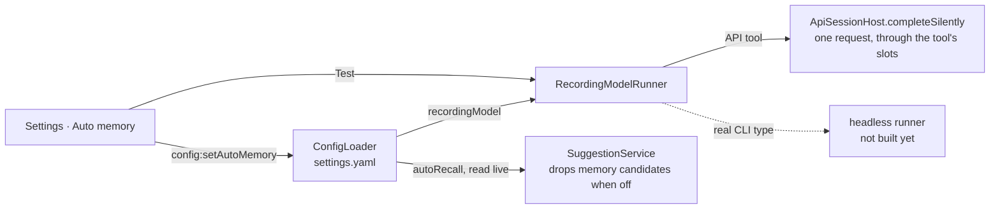

# Auto memory

Helm records the key facts of every session as memories and recalls them later, without the working model spending tokens on it. This document covers the parts that have shipped: the settings and the silent runner. The judge pass that reads `autoSave` is not built yet, so today the switch is stored and nothing records; the storage rules for the memories themselves are in [memory.md](memory.md).

## Settings

Settings → **Auto memory** holds one global setting, stored as `autoMemory` in `settings.yaml` under the user config dir.

| Field | Default | Meaning |
|---|---|---|
| `recordingModel` | none | CLI type id of the model that does the recording. |
| `autoSave` | on | Run the judge pass after each turn. With no model picked it does nothing, and the tab says so. |
| `autoRecall` | on | Let the suggester hint at memories. Skill hints are unaffected. |

- **One global model**, not one per project or per CLI type.
- **The picker lists Helm's configured CLI types.** API tools are pickable. Real CLI types (Claude Code, Codex, …) are listed disabled with "needs headless runner" until that runner exists. ComfyUI types are not listed: they have no text model.
- **A model that cannot record is refused, not stored.** `ConfigLoader.setAutoMemoryConfig` throws for a real CLI type, a ComfyUI type or an unknown reference, and the tab shows the reason. A pick that quietly records nothing would be worse than an error.
- **A stored pick that stops being runnable** (its CLI type deleted, or its `api` block removed) is flagged in the tab and Test is disabled; silent runs answer `failed`.
- **An API tool without a base URL or a model** is listed disabled as "API settings are incomplete" and refused.
- **Test** sends one small request to the picked model and reports whether it answered.

## Silent runs

Auto memory's judge never opens a session. It asks `SilentRunner.runSilently({ prompt, system? })` (`src/session/silent-model-runner.ts`) and reads the outcome:

| Result | When |
|---|---|
| `{ status: 'ok', text }` | The model answered. |
| `{ status: 'inert', reason }` | No recording model is picked. No request was made. |
| `{ status: 'failed', error }` | The request failed, the model returned no text, the picked type was deleted, or it is a real CLI type with no headless runner. |

`runSilently` never throws, and a failure never reaches the user's chat: it is logged and returned.

Callers depend on the interface only. Behind it, `RecordingModelRunner` resolves the picked CLI type and hands the request to the backend for its kind:

- **API tool**: `ApiSessionHost.completeSilently` sends one chat-completions request with no tools offered. It waits for one of that API tool's `slots`, the same queue its sessions and subagents use, so a judge pass queues behind real work instead of competing with it. Aborting the request while it is still queued gives its place up at once. No `PtyProcess`, no session row, no history file, no chat entry, no hook event.
- **Real CLI type**: no backend yet. The headless runner registers as the `cli` backend when it lands.

## Auto-recall switch

`SuggestionService` reads `autoRecall` on every prompt. Off means memory candidates are dropped before scoring, so no memory is hinted; skills are still suggested. Switching it back on needs no restart.
