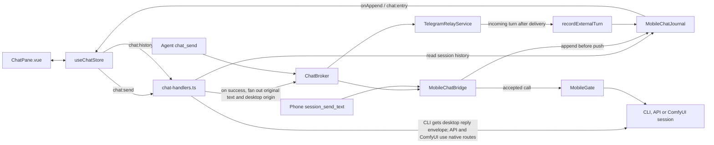

# Desktop Chat pane

The Chat pane (`Ctrl+Shift+J`) shows a journal-backed thread for the active
top-level session. The main sidebar, `Ctrl+Tab`, and `Ctrl+<digit>` choose the
session shown here. The thread shows messages, timestamps, safe web links,
attachment tiles and send status. Draft text and a chosen file are kept per
session.

`useChatStore` merges the initial history with the live feed by journal sequence.
It keeps drafts and attachments per session. Chat history is loaded for
top-level sessions while the pane is open, and live entries are merged once by
sequence.

User turns carry an `originId`: `desktop:` renders as **Desktop**, `telegram:`
as **Telegram**, and phone origins as **Phone**. Agent replies have no origin
badge. Telegram adds `[Desktop]` to the displayed text of desktop-sourced sends;
the journal and phone keep the original text. CLI-backed desktop Chat sends use
the existing `[HELM_MSG]` envelope and reply directive, marked as coming from
the user through **Desktop Chat**. The directive tells the agent to answer with
`chat_send`, which returns the reply to this pane. The journal still receives
and displays the original plain text with its `desktop:` origin. API sessions
stay unwrapped because their host already posts the model response to chat;
ComfyUI uses its generation submission path. An envelope would add reply
instructions to routes that already handle their own responses.

Right-clicking a message or the composer opens the shared terminal context
menu. Its Text group copies a selected message/composer range or pastes into the
composer at the saved caret; message-list paste appends to the draft. The
composer inserts a newline on Enter and sends on Ctrl+Enter. It grows with the
draft up to 30% of the window height, then scrolls internally, and shrinks when
text is removed or sent.

The context header shows the session name, mission, project folder, CLI label,
context tokens/window with the per-CLI amber/red thresholds and sparkline, plus
activity and session state. These values come from existing session metadata.

The ComfyUI profile and reference-gallery picker is a follow-up. The pane keeps
basic prompt and single-file submission, using the default profile and size.
