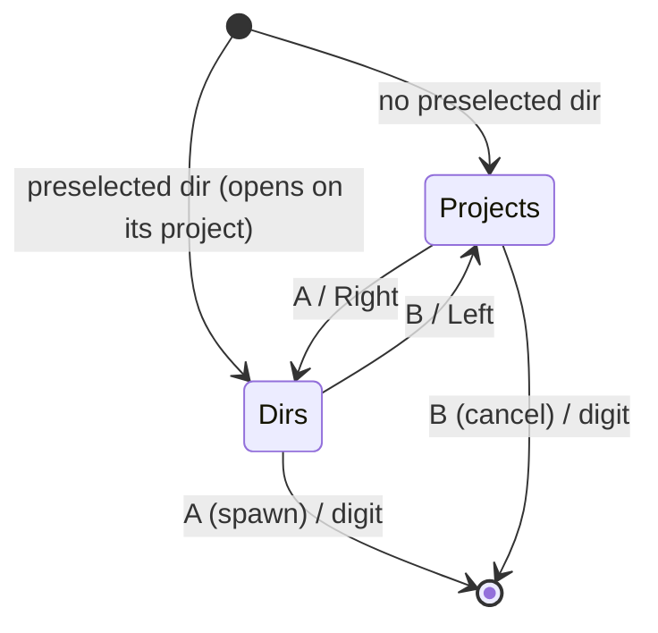

# Controls

Gamepad button and keyboard shortcut mappings.

## Gamepad

| Input | Action |
|-------|--------|
| D-Pad Up/Down | Switch sessions (auto-selects terminal) / move through group headers. The pinned **Helm** section is the first stop (it selects the operator's terminal) |
| D-Pad Right | Session card: cycle sub-elements / Group header: no-op — 🗺️ Plans button (col 1) is click-only |
| D-Pad Left | Back one sub-element column |
| Left Stick | Same as D-pad |
| Right Stick | Configurable (default: scroll terminal buffer) |
| A | Configurable binding (tool's binding profile) |
| B | Back to sessions zone / configurable binding (tool's binding profile) |
| X | Configurable binding (tool's binding profile) |
| Y | (planned: cycle terminal state) |
| Left Trigger | Spawn Claude Code |
| Right Bumper | Spawn Copilot CLI |
| Left / Right Bumper (Quick Spawn focused) | Previous / next machine tab; wraps |
| Back/Start | Switch profile (previous/next) |
| Sandwich/Guide | Focus hub window + show sessions screen |
| Any button bound to `voice-talk` | Hold to talk to Helm (the operator); release sends. The release is honoured from any pane |
| Any button bound to `voice-call` | Start / hang up a hands-free call with Helm (voice-activity detection sends each pause). A press while the mic is still opening cancels. Starting a call brings the Sessions pane (and its Helm section) into view |

### Session card columns

D-pad Right walks a focused session card's buttons; **A** activates the one you
are on.

| Column | Button | A does |
|--------|--------|--------|
| 0 | the card itself | falls through to the configured binding |
| 1 | state | open the state dropdown |
| 2 | ⋮ | open the session actions menu |
| 3 | ✕ | close (confirmation) |

A locked session shows 🔒 and its ✕ is disabled; closing is refused in the main
process too, so MCP, Telegram, group close, and force restart all bounce off it.
The same flag the `session_set_locked` MCP tool writes.

## Keyboard

| Input | Action |
|-------|--------|
| Ctrl+Tab | Next terminal tab |
| Ctrl+Shift+Tab | Previous terminal tab |
| Ctrl+Shift+T | Focus the Terminal pane |
| Ctrl+Shift+J | Focus the Chat pane and its composer; while Chat stays active, session changes return focus to the composer |
| Ctrl+Shift+M | Focus the Memories pane |
| Ctrl+Shift+P | Open/focus the Plans pane for the active session folder |
| Ctrl+Shift+S | Focus the Sessions pane |
| Ctrl+Shift+A | Show/focus the Artifacts pane; never toggles it |
| Ctrl+Shift+N | Open the machine-first Quick Spawn picker |
| Ctrl+Shift+W | Close the active session; works while typing and with Terminal hidden |
| Ctrl+Shift+R | Rename the active session; works while typing |
| Ctrl+Shift+B | Clear notifications for the active session; works while typing |
| Ctrl+Tab / Ctrl+Shift+Tab | Cycle the selected session forward/back (also from inside a text field). Moves the session spine only — the focused pane stays put and re-points at the new session |
| Arrow keys | Navigate the focused pane (mapped to D-pad equivalents). In Quick Spawn, left/right cycle machine tabs while a tab has focus; in the modal they cycle tabs directly. xterm owns arrows when the keystroke lands in it |
| Enter | Mapped to A button |
| Escape | Focused terminal: ESC protection (see below), else ESC to the PTY. Any other pane: the pane's own business (mapped to B button) |
| Delete | Mapped to X button |
| F5 | Mapped to Y button |
| Ctrl+V | Focused terminal: managed paste to PTY stdin (bracketed-paste framing, chunking). Focused Artifacts pane: creates a new artifact from the clipboard |
| Ctrl+G | Jump to the active session's Draft pane, caret in the pad. Works from anywhere, including while typing in a field |
| Ctrl+Shift+&lt;letter&gt; | Focus a dock pane from anywhere, text fields included: T terminal, J Chat, P plans, M memories, E mess, L timesheet, S sessions, H scheduler, Q quick spawn, F projects, A artifacts, D draft, K todos. Tabs show a shortcut chip and tooltip. Shared keys cycle matching panes in registry order; focus outside the set starts at the first |
| Ctrl+1-9, Ctrl+0 | Jump directly to the Nth session in sidebar order (badge: `^n`) |
| Alt+1-9, Alt+0 | Fire the Nth chip bar quick-action for the active session (badge: `⌥n`; 0 is slot 10) |
| Ctrl+Shift+Space | Talk to Helm: press to start, press again to send (a toggle — the router is keydown-only and key repeat makes a keyboard hold unreliable). Works while typing; a modal blocks it like the other workspace keys |
| Tab / Shift+Tab (selection-mode modal) | Cycle buttons in close-confirm, context-menu, or quick-spawn |

Global shortcuts with an editable-field opt-in still work while typing in Chat,
Draft and search fields, including session actions and the voice toggle. A modal
owns keyboard input ahead of global shortcuts.
The artifact iframe forwards Ctrl/Alt/Meta keydowns while focused, except
Ctrl/Cmd+C, Ctrl/Cmd+A and Ctrl/Cmd+F, which stay in the artifact. The keyboard
router handles only shortcuts with a registered action. In a snap-out window,
pane shortcuts are limited to that window's profile; session cycling and
main-window actions are unavailable. See the [focus-context matrix](keyboard-routing.md#shortcut-focus-context-matrix).

## Keyboard Ownership

Keyboard input is routed by a single capture-phase listener with an explicitly
declared precedence chain — `modal` > `global` > `pane` > `terminal`. Each screen
registers its own handlers and decides whether it is eligible, asking whether it
is **focused** (keys that send input) or **visible** (keys that render over a
pane). See [docs/keyboard-routing.md](keyboard-routing.md).

## ESC Protection

For CLI types with the setting armed, Escape in a focused terminal does **not**
go straight to the PTY — an accidental interrupt is expensive mid-run. The first
Escape raises a confirmation dialog instead; the interrupt is sent only if you
confirm.

| Input | Action |
|-------|--------|
| Escape (first press) | Raise the protection dialog. Nothing reaches the PTY |
| Escape / B (dialog open) | Confirm — ESC goes through to the PTY, dialog closes |
| Any other key (dialog open) | Dismiss. The interrupt is **not** sent |

Both routes converge on one handler, so the keyboard Escape and the gamepad B
button behave identically. The dialog owns its own confirmation: once it is up
it holds modal scope, which by design gates the terminal handlers out entirely
(see [keyboard-routing.md](keyboard-routing.md#modal-ownership-is-two-part)).

## Directory Picker (new session)

When the spawn dirs carry project metadata, the picker is master/detail: projects on the left, the focused project's dirs on the right (Main first, ungrouped dirs under a trailing **Other**). Without project metadata it is a single dir list. Grouping lives in `renderer/utils/dir-picker-model.ts` so a future one-step spawn sheet can reuse it.

The CLI and directory picker modals each have a search field. Search matches CLI names/ids, project names, directory names and full paths without regard to case. A project-name match keeps that project's directories; a directory/path match narrows the visible rows. The search field gets focus when the modal opens, and keyboard arrows or the gamepad navigate the filtered results. The same search behavior applies when scheduled-task pickers reuse these modals. No matches show an empty state.

Up/Down moves within the active pane; moving between projects resets dir focus. Digits `1`–`0` pick a dir of the focused project from either pane.

## Navigation Priority Chain

When a button is pressed, the navigation system checks handlers in this order:

1. Sandwich button (always → sessions screen)
2. Directory picker modal
3. Binding editor modal
4. Form modal (A/B only)
5. Close confirmation modal (Arrow keys + Tab/Shift+Tab for button cycling)
6. Quick-spawn picker
7. Item editor panel (plan / context; D-pad/A/B field navigation)
8. Context menu (Arrow keys + Tab/Shift+Tab for button cycling)
9. Screen-specific routing (sessions / settings — inside settings, `SettingsScreen` owns ◀▶ panes, ▲▼, A, B-back and LB/RB sub-tabs; see [settings.md](settings.md))
    - **Sessions case:** Plan screen overlay (when visible, B exits) → Session/spawn navigation
10. Config binding fallback (the active tool's binding profile)

The first handler that returns `true` (consumed) stops the chain.

## Draft

Prompt memos, the prompt-template picker and the Ctrl+G Prompt Editor popup were removed: three places to compose a prompt became one, the session's [Draft pane](draft.md) — a plain pad (also writable by the session's LLM) with **Send** / Ctrl+Enter. Ctrl+G now just jumps there. It has no gamepad binding.

## Directory Plans

The 🗺️ Plans button on group headers (column 1, click only) opens the plan canvas for that directory. The plan screen is an overlay inside `#mainArea`, not a separate screen — it's checked via `isPlanScreenVisible()` within the sessions case of the navigation router.

### Plan Screen Controls

| Input | Action |
|-------|--------|
| Click on node | Select node → open bottom editor panel |
| Click on arrow | Remove that dependency edge |
| Click + drag canvas | Pan (viewBox-based) |
| Mouse wheel | Zoom in/out |
| Ctrl+N | Add new node |
| Escape | Close plan screen (when editor is not open) |
| ← Back button | Exit plan screen |
| D-Pad Left/Right | Move between layers (closest-Y selection) |
| D-Pad Up/Down | Move within a layer |
| A (gamepad) | Open editor for selected node |
| X (gamepad) | Delete selected node |
| Y (gamepad) | Add new node |
| B (gamepad) | Exit plan screen |

Keyboard and clipboard paste are blocked while the plan screen is visible (`.plan-screen.visible` guard in paste-handler).

### Plan And Draft Editor Shortcuts

| Input | Action |
|-------|--------|
| Ctrl+S | Save and close the current draft/plan editor |
| Ctrl+Enter | Save and close the current draft/plan editor |
| Ctrl+N | Save current draft/plan item and create a new one |
| Escape | Cancel using the same close path as the visible Cancel action |

### Prompt Editor Modal

| Input | Action |
|-------|--------|
| Ctrl+Enter | Send the current textarea content to the active session |
| Escape | Close the prompt editor modal |
