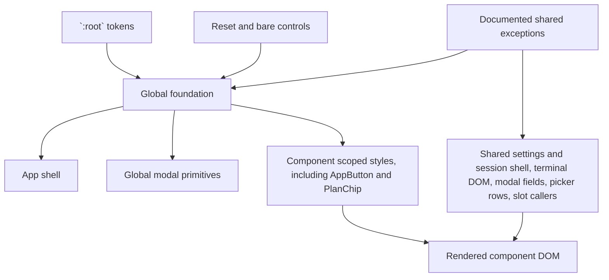

# CSS architecture

Helm has one dark visual language. The stylesheet boundary exists to keep that
language predictable as the renderer moves from imperative DOM to Vue.

## Ownership

`renderer/styles/main.css` owns the things that are truly global:

- `:root` design tokens, the reset, and bare form-control defaults;
- the application shell; recursive dock layout is scoped by its Vue components;
- shared `.modal*` primitives; and
- documented global compatibility families whose DOM cannot safely be scoped.

A component owns its visual DOM in a `<style scoped>` block. Move a rule with
the DOM owner, not with the section heading where the rule happened to be
written. Before moving a class, search the class across `renderer/` and
`src/`, including templates, TypeScript, and DOM-building helpers.

The recursive dock layout lives with `DockWorkspace.vue`, `DockNode.vue`,
`DockTabGroup.vue`, `DockPane.vue`, `DockSplitter.vue`, `DockPreview.vue`,
`DockViewMenu.vue`, `NewItemPulse.vue`, and `DockPaneBody.vue`.
The app-shell relationship and body drag cursor stay narrow global selectors
in their owning component styles.

The shared token vocabulary is:

| Purpose | Tokens |
| --- | --- |
| Surfaces | `--bg-primary`, `--bg-secondary`, `--bg-tertiary`, `--bg-hover` |
| Text | `--text-primary`, `--text-secondary`, `--text-dim` |
| Accent and focus | `--accent` (lime `#ccff00`, shared with the phone), `--accent-rgb` (for `rgba(var(--accent-rgb), a)` — never a literal), `--accent-hover`, `--accent-contrast` (text on an accent fill — never white), `--focus` |
| Semantic state | `--danger`, `--danger-border`, `--info`, `--status-*` |
| Shape and spacing | `--radius-*`, `--spacing-*` |
| Type and effects | `--font-size-*`, `--font-mono`, `--shadow*` |
| Shared context menu | `--context-menu-*` (fixed compatibility palette) |

Raw hex colours are not acceptable in component CSS. Add or reuse a token in
`:root`, then consume the token from the component. Semantic status colours
remain semantic; do not replace them with the accent merely for consistency.

## Why global exceptions exist

Vue scopes `.foo` as approximately `.foo[data-v-x]`. That attribute selector
has greater specificity than global `.foo`, regardless of source order. A
move can therefore invert relationships such as hover versus selected,
disabled versus enabled, focus versus base, SVG descendants, or
`:not(.selected)`. Audit paired states together whenever a rule moves.

Four cases make a global rule safer than a superficially tidy scoped rule:

1. **Teleported DOM.** `<Teleport to="body">` moves nodes out of the normal
   component subtree. `SequencePanel.vue` teleports its modal, so a rule moved
   to `PlanScreen.vue` would stop matching. A rule may be global, or may live
   in the teleporting component itself, which still stamps its own scope onto
   its teleported children. Check for `<Teleport` before assigning an owner.

2. **Imperatively created DOM.** Nodes created with `document.createElement`
   in TypeScript do not receive a Vue `data-v` attribute. The terminal manager
   creates `.terminal-pane` at its creation sites. Its terminal/xterm rules
   must remain reachable globally.

3. **Genuinely shared classes.** A class rendered by multiple components has no
   single scoped owner. `ContextMenu.vue` keeps the shared context-menu styles beside its
   template with `:global()` selectors because `RuntimeGroupMoveSubmenu.vue` renders
   the same surface in a sibling teleported tree. The `.tg-*` family is shared by
   the MCP and fleet settings components. The session screen shell remains
   global because it spans siblings. `SessionCard`, `SessionGroup`, `SessionList`,
   and `SortBar` own their visual rules in scoped styles; `OperatorSection` owns its
   activity dot. `.jump-key` stays global because picker modals and dock tabs share it.

4. **Slot content.** Slot content is stamped with the parent's scope id, not
   the child's. A child rule targeting DOM supplied through a slot can silently
   stop matching. The caller owns slot content and its styles. This is also why
   `plan-header__chip` remains global across `PlanScreen.vue` and `SkillsTab.vue`.

The remaining explicit compatibility families in `main.css` are the session
screen shell, terminal and xterm classes, shared settings surfaces, the field
layout shared by the teleported `BindingEditorModal` and `FormModal`, and the
shared picker selectors `.dir-picker-list`, `.dir-picker-item`,
`.dir-picker-item__body`, and `.dir-picker-item__name`, which are rendered by
both `DirPickerModal` and `QuickSpawnModal`. The
`.plan-chip` family is scoped in `PlanChip.vue`; `ItemEditor.vue` reuses its
compact variant. `.jump-key` remains global because picker modals and dock tabs
share it. The structural CSS test keeps this list explicit so a new global
selector requires a deliberate rationale. It also ratchets the current non-core
selector count; that baseline may only decrease as legacy rules move to their
component owners.

## Shared primitives

Use the primitives in `renderer/components/common/` when the DOM has a shared
visual contract:

- `PanelHeader` provides the icon/title/subtitle/action layout. Search belongs
  in its toolbar slot when the list below is filtered.
- `SearchField` provides the standard search input and clear affordance.
- `ListRow` provides the common list-row structure and focus treatment.
- `EmptyState` provides an empty/loading state with an optional action slot.
- `Chip` is display-only. It is not a button.
- `FilterChip` is the interactive tri-state control and carries `aria-pressed`.
- `PromptTextarea` owns prompt input behavior and focus handling.
- `AppButton` owns the shared button variants and focus treatment; use it for
  template buttons. Native selects with the shared control variants use the
  `.app-select` classes to preserve native selection behavior.

Do not merge `Chip` and `FilterChip`: their accessibility and interaction
contracts are intentionally different.

## Selection language

List rows use an inset accent bar plus a subtle selected surface. The bar keeps
keyboard/gamepad focus and selection legible without overwhelming a dense
list. The canvas uses an accent outline because it selects an object on a
surface; an inset bar has no meaningful edge there. Hover must remain visibly
distinct from selected in both languages.

Settings uses a third language and no edge bar: selected/active is a tinted
fill (`--accent-tint`) with accent text, and gamepad focus is a separate inset
ring (`--focus-ring`), so selection and focus can show at once without one
hiding the other. The page components predate it and share class names, so
the switch / card / ring rules live once in `main.css` under `.settings-screen`.
See [settings.md](settings.md).

Settings content uses the available page width. The global `.settings-sections`
grid auto-fits columns with `minmax(520px, 1fr)`; `.settings-span` lets wide
tables, lists, and long prompts span the row. List and form pages keep a single
column, while intentional master-detail panes retain their own split.

Keep scoped `display`, `flex-direction`, and `gap` rules off `.settings-sections`.
Vue's scoped selector is more specific than the global class, so a local flex
rule can override and disable the shared grid.

## Buttons

`AppButton.vue` owns button layout, typography, focus-visible treatment,
disabled state, and the primary, secondary, danger, ghost, and success variants.
Primary buttons use `--accent-contrast` against `--accent`; danger buttons use
`--danger` and `--danger-border` while retaining the established
outlined/translucent appearance.

The formerly local button systems (`PeersTab` and `PeerPairingDialog`) now use
the shared AppButton variants. Button styles live with AppButton instead of in
the global stylesheet.

Settings selects remain native elements so `v-model`, change handlers, and
browser selection behavior stay native. Their shared `.app-select` variants
live in `main.css` alongside the base form-control styles.

## Layering

When in doubt, identify the actual DOM owner first, then check the four
exceptions and paired-state specificity before moving the rule.

## Known visual-review note

`PlanScreen.vue` still has `stroke: var(--accent) !important` on the selected
node rectangle (currently around line 1102). It predates this cleanup. Scoped
styles may make it unnecessary, but removing it changes canvas rendering and
requires a human visual check, so it remains intentionally unchanged.
