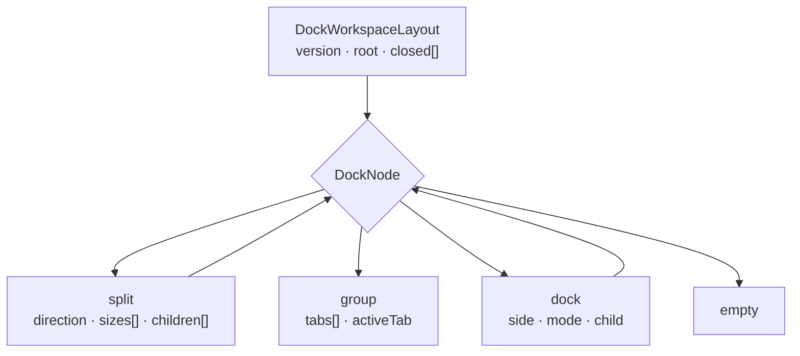

# Docking Workspace

The prompt-IDE workspace: a recursive, persisted layout tree in which every view
and tool window is a **pane**. Panes can be tabbed, split, docked to an edge,
collapsed to a rail, closed, and restored.

## Model

The tree is plain serializable data — no DOM selectors, no Vue constructs — so
the renderer decides placement and a live xterm element can be *adopted* into a
new position rather than remounted.

| File | Role |
|------|------|
| `renderer/dock-types.ts` | Node types, geometry constants, and the pane registry |
| `renderer/dock-layout.ts` | Pure tree operations — every function takes a layout and returns a new one |
| `renderer/dock-persistence.ts` | Loads/validates the untrusted persisted layout; legacy migration |
| `renderer/composables/useDockWorkspace.ts` | Reactive wrapper: focus identity, reveal state, persistence queue |
| `renderer/dock-pane-registry.ts` | Static pane components plus runtime descriptor/component registration |
| `renderer/dock-registry-state.ts` | Vue revision signal for runtime registry changes |
| `renderer/components/dock/*.vue` | Recursive renderer — nodes, tab groups, splitters, rails, drag preview |
| `renderer/dock-visibility-bridge.ts` | Hands pane visibility to the imperative gamepad nav in `screens/` |

## The pane registry

`DOCK_PANES` in `dock-types.ts` defines static pane identity. The general
`dockPaneRegistry` also accepts runtime descriptors and matching components via
`registerDockPane()` / `unregisterDockPane()`. Dynamic ids use a namespace, such
as `sessions:<peerId>`; the dock model does not contain fleet-specific cases.
Static panes keep their existing registry and profile behavior.

| Field | Meaning |
|-------|---------|
| `title` | Shown on the tab and as the rail tooltip |
| `icon` | Glyph on a collapsed dock's rail |
| `hint` | Optional keyboard hint, surfaced as the tab tooltip |
| `home` | `DockSide \| 'center'` — where the pane lands when restored |
| `closable` | Whether it can be closed to the View menu |

## Pane profiles

A window hosts a **subset** of the registry, named by a `DockProfileId`. The
profile is data, like the registry itself, so the default layout, the validator
and the View menu all read one allow-list.

| Profile | Panes | Window |
|---------|-------|--------|
| `main` | every registered pane (derived, never re-listed), including runtime panes | `MainWindowApp.vue` |
| `popout` | terminal, plans, memories, mess, artifacts, draft | `SnapOutWindow.vue` |

The pop-out omits the session list, quick spawn, scheduler and projects: those
act on things the main shell owns.

Each profile persists its own tree. `main` keeps the original `workspaceLayout`
settings field; `popout` writes `popoutWorkspaceLayout`, and the profile travels
with `configGet/SetWorkspaceLayout`. There is **one** pop-out layout shared by
every snapped-out window, not one per session.

### The pop-out shell

A snapped-out window is a real workspace bound to one session. `SnapOutWindow.vue`
pins `activeSessionId` during setup (`pinActiveSession`), after which
`setActiveSessionId` is a no-op for the lifetime of the window. Every pane reads
the store, so pinning is the whole of the binding — no session state is copied
into props and no pane knows it is in a pop-out.

The `terminal` pane is overridden with `PopOutTerminalPane.vue`: the main window's
`TerminalPane` hands its container to the shared `TerminalManager`, which a
pop-out does not have, so the pop-out pane owns its `TerminalView` directly
(attach → replay → live `pty:data`). PTY ownership is released only on snap-back,
never on pane close.

The window carries a slim `app-header`: the pinned session's identity on the left
(name, CLI, folder — the same derivation as the OS window title) and the **View
menu** on the right, listing the `popout` profile's panes. Without it a closed
pane would be unrecoverable, since a pop-out has no other entry point. Help, logs
and settings stay in the main window — they are app-global, not per-window.

## Titling and collapse have one owner

The dock names a pane (tab + rail tooltip) and collapses it (rail). **Pane
components render content only** — no section header, no collapse toggle. A pane
that draws its own title bar is duplicating the dock and is a bug.

Likewise there is exactly one collapse concept: a dock's `mode`.

| Mode | Behaviour |
|------|-----------|
| `pinned` | Content always visible; no rail and no collapse toggle |
| `autohide` | Collapsed to its rail; opens on rail click or focus, re-collapses on focus-out |
| `hidden` | Collapsed and stays collapsed until explicitly opened |

The **left dock is always `pinned`** — it is shrunk with its splitter, never
collapsed. The model enforces this on every mode change and on load, so a layout
saved while a collapse control existed is repaired rather than stranded on a rail.

Reveal state (which autohide docks are currently open) is **session state, not
layout** — it is deliberately outside the persisted tree, so an opened autohide
dock re-collapses on the next launch.

### The rail

A collapsed dock renders a rail of **one icon button per pane in the dock**;
clicking an icon opens *that* pane. Rails never contain rotated text — a ~34px
strip fits a glyph and a tooltip, not a legible word.

A pinned dock renders **no rail** and offers no collapse. Its rail used to carry
only a collapse chevron, which on a left/right dock laid out as a blank
full-width strip along the bottom edge. A pinned dock's space is reclaimed
by closing the pane (the View menu restores it).

## Closing and restoring

`closePane` removes the pane from the tree and appends it to `layout.closed`;
empty groups and emptied docks are pruned by `normalizeNode`. Recovery is the
**View menu** in the header, which lists open and closed panes separately and
badges the trigger with the number of recoverable panes.

`restorePane` resolves a landing spot in this order:

1. an explicit `DropTarget` (drag, or restore-to-here);
2. `home: 'center'` → the first group not inside an edge dock, as a tab;
3. `home: <side>` → the live dock on that side, as a tab;
4. **no such dock** → the edge dock is recreated at `OUTER_EDGE_RATIO`.

Step 4 is load-bearing. Homes are anchored on an *edge*, never on a sibling
pane: a sibling can itself be closed, and anchoring on one used to strand a
restored tool window as a tab in the centre group behind Terminal — which read
as "it never came back".

Homes live in the registry, not in the persisted tree, so changing a pane's home
does not invalidate a saved layout.

Runtime panes use the same close and restore path as static panes. Closing a
peer's Sessions pane stores its id in `closed`; reconnecting does not reopen it,
and the main View menu can restore it. The peer registry re-adds a pane only
when that peer is still paired and Fleet is enabled.

## Workspace shortcuts and view lifecycle

The dock owns pane selection. Two panes — **Terminal** and **Plans** — also
represent a *view mode* and therefore pass through the navigation store's
mount/unmount lifecycle, whichever way they are selected (tab, rail, View menu,
shortcut). `renderer/composables/useDockViewRouting.ts` is the single place that
maps between the two, so the dock mirrors `main-view-manager` instead of
becoming a second routing path. Selecting Terminal closes the active plan
lifecycle before focusing the terminal.

Every other pane is a tool pane over existing state. Focusing a tool pane is a
focus move and nothing else: a view transition started from `focusin` would
cancel the click that is about to select a session.

Panes can declare a `Ctrl+Shift+<letter>` shortcut on their
`DockPaneDescriptor` (`renderer/dock-types.ts`): T terminal, J Chat, P plans, M
memories, E mess, L timesheet, S sessions, H scheduler, Q quick spawn, F
projects, A artifacts, D draft. The router and the visible tab key chip (also
shown in the tooltip) read the descriptor through `paneShortcutHint` in
`renderer/dock-shortcuts.ts`. These keys work from anywhere, text fields
included — Ctrl+Shift+letter types nothing, so claiming it costs the field
nothing. A shortcut shows/focuses its pane; it does not toggle visibility. If
multiple panes share a key, each press advances to the next matching pane in
registry order and wraps around; focus outside that set starts at its first
pane. `Ctrl+Shift+N` remains the new-session shortcut, and Ctrl+G is an alias
for the Draft pane.

**Caret on focus.** A pane field marked `data-autofocus` takes the caret when
the dock focuses that pane (`DockPane.vue`), so a jump lands ready to type. The
Draft textarea and Chat composer use it; tab clicks and gamepad focus follow
the same dock focus path. While Chat is the active pane, changing the selected
session also returns focus to its composer, regardless of whether the change
came from the sidebar, a session shortcut, D-pad navigation or session spawn.
An inactive Chat pane never steals focus.

The `popout` window uses the same descriptor shortcuts filtered to its profile:
Terminal, Plans, Memories, Mess, Artifacts and Draft. It also supports Ctrl+G
and session-slot/chip-action digit shortcuts; session cycling and shell-owned
actions stay in the main window.

Pane content does not provide a second close control. The dock tab close button
is the close action, the View menu restores closed panes, and rails reveal
collapsed or autohide panes.

The Quick Spawn pane lists tools for the selected machine. Its tabs show This
PC and eligible fleet peers when any are available; selecting a tool opens the
folder picker for that same machine. With the pane focused, Left/Right Bumper
cycles machine tabs. Keyboard left/right cycles tabs while a machine tab has
focus, and the tabs remain clickable. With no eligible peer, the pane keeps its
local tool list without showing tabs.

## Chips belong to the terminal

`TerminalChips` (plan pills + quick actions) mounts **inside** `TerminalPane`, at
its foot — not as a band across the shell. Its visibility is therefore "the
terminal pane is rendered", which the dock already decides, and it travels with
the pane when the pane is moved, split or docked.

`TerminalChips` is a thin store adapter over `ChipBar`; the same component serves
the docked pane and a snapped-out window, so there is one chip-row
implementation.

Chip text lines that would be clipped by the fixed 180px chip width tick
continuously instead: `TickerText` (renderer/components/chips/) measures each
line, and only clipped ones loop as a seamless two-copy marquee at a constant
speed. Lines that fit stay static with ellipsis, and `prefers-reduced-motion`
falls back to plain ellipsis.

## New-item "+1"

A new memory, Mess post, artifact or plan floats a `+1` over that pane's rail
button and tab, fading over 1.2 s; quick bursts stack. Only creations count —
edits, links and new versions do not — so main emits dedicated `plan:created` /
`artifact:created` events next to the generic `*:changed` invalidations, and
memory uses the `type: 'create'` already on `memory:changed`.
`renderer/composables/useNewItemPulse.ts` owns the state, subscribed once by
the main window; `NewItemPulse.vue` renders it.

## Gamepad navigation

The imperative nav in `renderer/screens/` must skip zones that cannot take
focus. It asks `isPaneVisible(paneId)` from `dock-visibility-bridge.ts`, which
the shell backs with `dockWorkspace.isVisible` — accounting for collapsed rails,
hidden docks and inactive tabs in one answer. Nav modules never track collapse
state of their own.

## Persistence

The layout is stored by the main process as an opaque value
(`config:get/setWorkspaceLayout`) — main never interprets the renderer's schema,
so an older build can still load settings written by a newer renderer. The
renderer validates on load and falls back to the Classic default if the value
does not satisfy the schema.

A namespaced pane id whose descriptor has not registered yet keeps its saved
tree slot. The component mounts when the descriptor registers; after the peer
registry has finished loading, ids that have no owner are pruned. This lets
saved dynamic panes survive startup ordering without preserving panes for peers
that were unpaired.

`projectVisibleLayout()` in `renderer/dock-layout.ts` applies that same
registered-id filter for rendering. It records source paths for visible splits,
so `resizeVisibleSplit()` can map a drag back to the saved tree while preserving
the share assigned to hidden children. A split with one visible child collapses
in the view; an empty dock disappears. `pruneUnregisteredPanes()` uses the same
projection before normalizing the persisted tree.

The Classic default is one horizontal root split with two tracks: a pinned
left dock with Sessions and Scheduler as tabs, and a centre column split top
and bottom: the view group (Terminal / Artifacts / Statistics / Mess /
Memories / Plans, Terminal active) above the [Draft](draft.md). Quick spawn
and Plan directories start closed and come back from the restore menu. Dock
behaviour tests use their own edge-dock fixture, so the default can change
without rewriting them.

**Retired panes.** A saved layout may name a pane id that no longer exists.
`validateLayout` prunes retired ids before validating and hands the freed share
back to neighbouring panes, rather than rejecting the layout and discarding the
user's whole arrangement for one missing pane.

**Renamed panes.** `RENAMED_PANE_IDS` in `renderer/dock-layout.ts` maps an old
id to its new one (`scratchpad` → `draft`) before validation, so a rename keeps
the pane where the user put it instead of pruning it and re-adding it at the
default spot.

## Related

- [preload-api-boundary.md](preload-api-boundary.md) — IPC/contextBridge rules
- [terminal-architecture.md](terminal-architecture.md) — PTY stack and terminal adoption
- [artifact-viewer.md](artifact-viewer.md) — the Artifacts pane
