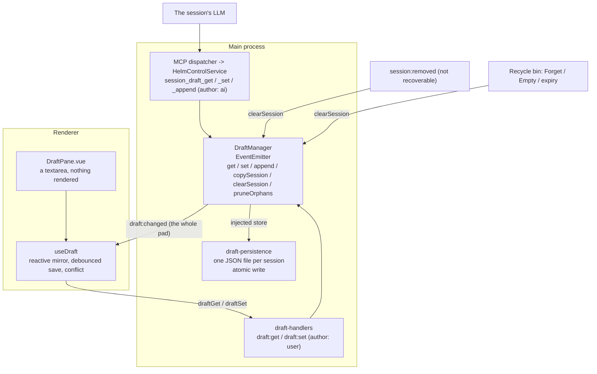
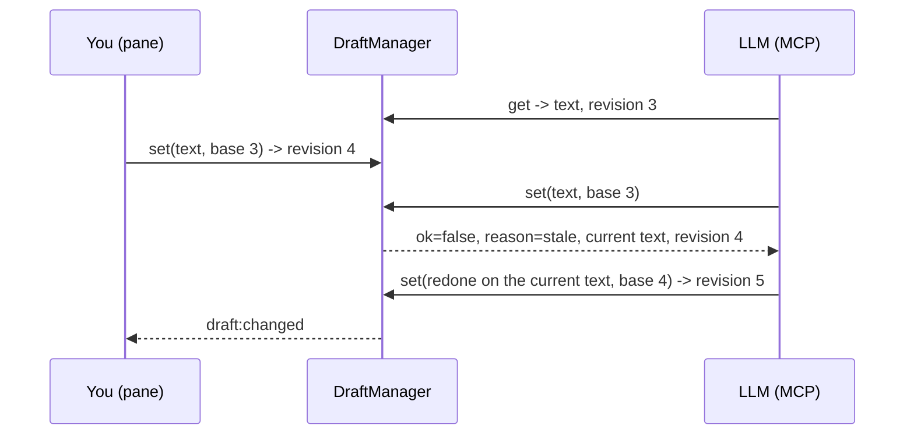

# Session Draft

One plain-text pad per session that **you and the session's LLM both write**.
You type in the Draft tool window; the LLM reads and writes the same text
through MCP, and its edits show up in the pane as they land.

## Why this exists

A session had no shared working surface, and composing a prompt had three
competing homes (prompt memos, a prompt-template library, a Ctrl+G editor
popup). All three were removed: this pad is the one place to write, notes or a
prompt, and **Send** turns it into input. The neighbours each do a different job:

| Feature | What it holds | Who writes |
|---|---|---|
| [Mission](mission-statement.md) | One TL;DR of what the session is for | You and the AI |
| [Artifacts](artifact-viewer.md) | Finished, versioned reports | The AI (you can edit) |
| [Memory](memory.md) | Knowledge that outlives the session | The AI |
| **Draft** | The running notes of this one session: a to-do list, a pasted error, numbers to remember | You and the AI |

## Model

```
Draft { sessionId, text, revision, updatedAt?, updatedBy?: 'user' | 'ai' }

DraftManager: sessionId -> Draft   (loaded on first use)
  -> %APPDATA%/Helm/config/drafts/<sessionId>.json
```

A pad never written is `{ text: '', revision: 0 }` and has no file. Every change
adds one to `revision`, including emptying the pad: the number never goes back,
so a writer holding an old revision stays stale.

## Architecture



## Two writers, one rule

Both sides can write at any moment, so a **replace names the revision it was
based on**, and one based on an old revision is refused with the pad as it
stands. That is the whole concurrency model. There is no merge and no CRDT: a
pad is a few lines of notes, and a refused write that says why is easier to
trust than a merge that guesses.



- **Append needs no revision.** It only adds a line at the end, so it cannot
  drop anything. It is the cheap way for an LLM to leave a note.
- **The pane never loses your typing.** An edit from elsewhere replaces the text
  only when you have nothing unsaved. If you do, both versions are kept: the pad
  in main holds theirs, the editor holds yours, saving stops, and a bar offers
  **Keep mine** (your text is written over theirs, on purpose) or **Take
  theirs**.
- **A conflict stops every save, queued ones included.** The check is made
  when a save starts, not when it was queued, so a save waiting behind a refused
  one cannot slip through on the newer revision.
- **Leaving does not drop typing that could not be saved.** The mirror keeps
  its state per session, not per pane. Switch session or close the pane with a
  conflict open, or with a pad too large to save, and your text is still in the
  editor, with the choice or the reason, when that session's pad is next shown.
  A save still on its way when you leave lands on the session it was for. This
  lives in the window's memory: closing the window or quitting Helm loses text
  that was never saved, and the pad keeps what main had.
- **An external edit does not move your caret.** Setting a textarea's value
  drops the caret at the end; the pane puts it back.
- **The pane's own save is not "someone else".** The change event for a save
  this window sent is recognised by the text still in flight, so typing on
  during a save raises no false conflict.

## Limits

- **64 KB of UTF-8** (`DRAFT_MAX_BYTES`). A larger write is refused and the
  old text is kept. The cap bounds the file, the IPC payload and what an LLM
  pulls into its context on a read.
- **Plain text, never rendered.** What the LLM writes is untrusted (invariant
  9), so the pad is only ever the value of a `<textarea>`. A markdown preview,
  if one is ever added, must go through the sanitizer.

## Lifecycle

The pad belongs to the Helm session id, not to the CLI's conversation.

| Event | The pad |
|---|---|
| Helm restart, resume | Kept |
| `/compact`, Quick Compact | Kept (same session id) |
| Switch CLI | The replacement session gets a **copy**; the closed source keeps its own for a restore |
| Clone, or Switch CLI that leaves the source open (`closeSource: false`, locked source) | The new session starts **empty**: two live sessions never share or fork a pad |
| Close to the [recycle bin](recycle-bin.md) | Kept; back on restore |
| Forget, Empty, 30-day expiry | Deleted |
| Close of a session that cannot be restored | Deleted |
| Crash that skipped the cleanup | Reclaimed at the next start (`pruneOrphans`: kept only for live and binned sessions) |

The user-side write path accepts live and binned sessions only, so a late save
cannot create a pad nothing will ever read or delete.

## MCP

| Tool | Arguments | Notes |
|---|---|---|
| `session_draft_get` | `sessionId?` | Yours by default; another session's pad can be read by id or exact name. Returns `text`, `revision`, `bytes`, `maxBytes`. |
| `session_draft_set` | `text`, `revision` | Your own pad only. A stale revision returns `ok: false, reason: "stale"` with the current `text` and `revision`. |
| `session_draft_append` | `text` | Your own pad only. Adds the text on a new line at the end. |

Writes are always the **caller's own** session, taken from the server-derived
identity; naming another session is an error rather than a silent write to your
own pad. A successful write returns the new `revision` and size, not the text.
Helm does not inject the pad into prompts: the LLM reads it when it needs it.
Phones and fleet peers get these tools only through their allow-lists, and their
proxy identity is not a session, so they have no pad to write.

## UI

`renderer/components/dock/DraftPane.vue`, the `draft` pane: a tool
window homed on the right edge next to Artifacts, in the main window and in a
snapped-out session window. It follows the active session.

- Saves 400 ms after you stop typing, on blur, on a session switch and when the
  pane goes away.
- Footer: `Saving`, `Saved` or `Last edit by the AI`, and the size against the cap.
- **Send** (button or Ctrl+Enter) types the pad into the session's CLI through
  the normal paste path, submits it, then clears and saves the empty pad — the
  pad doubles as a prompt composer. Plain Enter is a new line; an empty pad sends nothing.
  A frozen session takes no input, so Send does nothing and the pad keeps its text.
- **Ctrl+G** or **Ctrl+Shift+D** jumps here from anywhere, even mid-typing in
  another field. The textarea carries `data-autofocus`, so the caret lands in it
  whenever the dock focuses the pane.
- A layout saved before this pane existed gets it as a closed pane in the
  **View** menu; one saved with the old `scratchpad` tab id is renamed to
  `draft` on load ([docking.md](docking.md)).
- Typing counts as your time on the session's project ([time-tracking.md](time-tracking.md)).
- No gamepad binding.

## Persistence

| Aspect | Detail |
|---|---|
| Path | `%APPDATA%/Helm/config/drafts/<sessionId>.json` (`DRAFTS_DIR`), one file per session so one session's edits never rewrite another's text |
| Write | `atomicWriteFileSync` |
| Read | Field-checked; a damaged file reads as an empty pad |
| Failure mode | Save and load errors are logged, never thrown. A pad that could not be saved lives in memory until Helm exits. |
