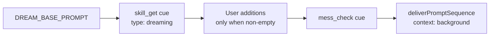
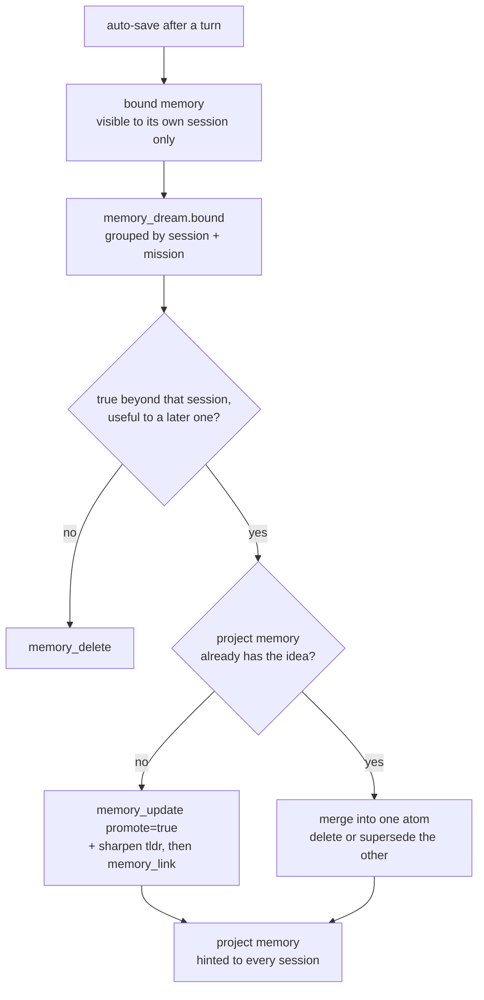

# Dreaming

A **dream** is a scheduled maintenance pass over one project's durable memories. Helm seeds one disabled dream task per project; enabling it gives that project a daily housekeeping run that prunes, consolidates and sharpens what the project already knows.

Dreams are ordinary scheduled tasks with `systemKind: 'dream'` (`src/session/scheduled-task-manager.ts`). Helm owns their prompt and title; the user owns the time, the CLI, the enabled toggle, and an optional prompt addendum.

## Delivered prompt

The prompt is deliberately short. It cues the `dreaming` system skill rather than restating the procedure, so the guidance can be revised in one place without touching the scheduler.

Assembled by `buildDreamPrompt` and delivered as the spawned session's `contextText` — the same mechanism a user-created session uses for its initial prompt. It is **not** delivered from an `onPromptComplete` callback: a missed callback used to leave the dream session with nothing but the `[HELM_MESS]` reminder.

The procedure itself lives in the `dreaming` system skill (`src/mcp/guides/dream-guide.ts`, registered as `sys-dream` in `helm-control-service.ts`). Like every system skill it is shadowed by a user skill of the same `type`, so a project can override the dreaming procedure without a code change.

## Digesting session-bound memories

Auto-saved memories are session-bound: only the session that produced them can see them ([memory.md](memory.md#session-bound-memories)). A dream is the only way they become project knowledge, and the only caller the binding does not apply to.

- **Who is a dream.** A session is a dream when the scheduler spawned it for a `systemKind: 'dream'` task and that run has not ended (`ScheduledTaskManager.isDreamSession`); the scheduled run and Run now both count. The status is tracked per spawned session, not read off the task row, so pointing a dream row at an existing session (direct mode) never makes that session a dream, and it does not survive a restart. A session that calls `memory_dream` by hand is not one: it gets the faded and salient lists and an empty `bound`.
- **What a dream may do.** For bound memories of its own project, the ordinary tools simply work: `memory_get`, `memory_search`, `memory_update`, `memory_link`, `memory_delete`. There is no second tool set. `MemoryManager.hiddenFrom` is the single rule, and it lifts for nobody else and for no other project.
- **Unattended.** A dream spawns without the CLI type's configured initial prompt (`skipInitialPrompt`; the rename still runs), and its prompt opens with `DREAM_UNATTENDED_CUE`, so interactive house rules such as plan-first never stall it waiting for approval.
- **What a dream may see.** Beyond bound memories, a dream's reads (`memory_list`, `memory_get`, `memory_search`, `memory_graph`, `memory_export`) also include its project's dormant memories and every unscoped memory (no project, so no project's privacy is crossed). Reading a dormant memory as a dream does not revive it — that is review, not retrieval. Other projects and private projects stay out of reach.
- **Promote.** `memory_update` with `promote: true` clears the binding. Any other caller is refused, the owning session included: the binding exists so that an unattended write is read by a dream before the project inherits it. Promotion and the rewrite are one write (`MemoryManager.update`), so a refused caller or a stale `expectedUpdatedAt` changes nothing. Promotion alone does not touch `updatedAt`.
- **The list.** `bound` holds up to `maxCandidates` memories, oldest first, each with its full content; `totals.bound` counts all that are waiting, so a capped dream knows the next one has more. Dormant bound memories are left out.
- **Closed sessions.** Their bound memories are kept for this and are listed with `mission: null`.
- **Duplicates.** The judge only dedupes within its own window, so the same fact saved late in a session or by two sessions is resolved here.
- **The procedure** is the `[bound_memories]` section of the `dreaming` skill. A user skill of type `dreaming` that shadows it must carry its own digest steps, or bound memories pile up unseen.

## Scheduling

- The sidebar resolves the exact instant the user picked and sends it as `scheduledTime` alongside a daily cron expression.
- `updateTask` recomputes `nextRunAt` **only** when the schedule itself changes (`scheduledTime`, `scheduleKind`, `cronExpression`, `endDate`). Recomputing on every patch pushed a daily task out a further day per edit.
- A failed or healed dream is put back on its configured hour via `nextDreamRun`, not at `now + 24h`, so a hiccup does not walk the dream off its time.

## Run now

The play button in the dream row fires an extra occurrence immediately (`runTaskNow`). `nextRunAt` and `scheduledTime` are restored once the run starts, so "run now" can never act as "postpone". A disabled dream can still be run on demand — the toggle governs the timer, not the button.

## Related

| Document | Content |
|----------|---------|
| [scheduled-task-history.md](scheduled-task-history.md) | 7-day rolling run log of scheduled-task executions |
| [mess.md](mess.md) | The project conversation a dream checks on completion |
