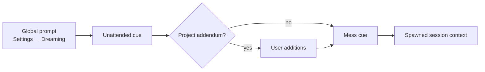
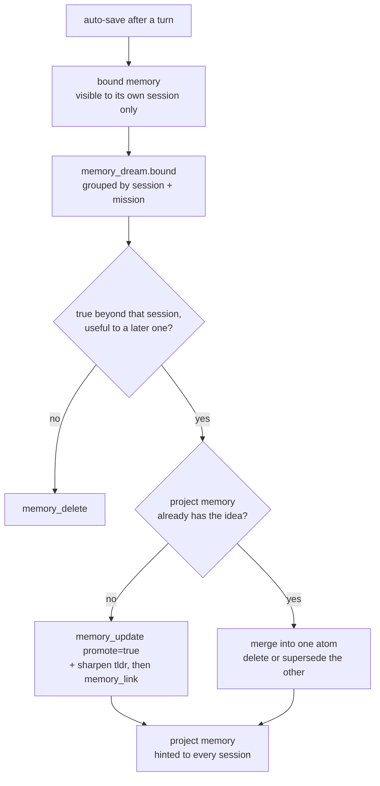

# Dreaming

A **dream** is a scheduled maintenance pass over one project's durable memories. Helm seeds one disabled dream task per project; enabling it gives that project a daily housekeeping run that prunes, consolidates and sharpens what the project already knows.

Dreams are ordinary scheduled tasks with `systemKind: 'dream'`. Helm creates one disabled row per project. The global prompt is shared; each project keeps its own CLI, daily time, enabled state, and optional addendum.

## Prompt used for each run

Settings → **Dreaming** stores one editable prompt for every project's run, with a reset to the shipped default. The default contains the memory-maintenance procedure; a project row can append a project-specific addendum.

The order is global prompt → unattended cue → optional addendum → mess cue. The complete prompt is present when the dream starts, so the memory procedure and the instructions that make the run unattended cannot be lost while a session is opening.

The former system skill was removed because a global prompt gives every project one editable default and avoids a skill lookup that a project-specific skill could shadow.

## Digesting session-bound memories

Auto-saved memories are session-bound: only the session that produced them can see them ([memory.md](memory.md#session-bound-memories)). A dream is the only way they become project knowledge, and the only caller the binding does not apply to.

- **Who is a dream.** A session is a dream when the scheduler spawned it for a `systemKind: 'dream'` task and that run has not ended (`ScheduledTaskManager.isDreamSession`); the scheduled run and Run now both count. The status is tracked per spawned session, not read off the task row, so pointing a dream row at an existing session (direct mode) never makes that session a dream, and it does not survive a restart. A session that calls `memory_dream` by hand is not one: it gets the faded and salient lists and an empty `bound`.
- **What a dream may do.** For bound memories of its own project, the ordinary tools simply work: `memory_get`, `memory_search`, `memory_update`, `memory_link`, `memory_delete`. There is no second tool set. `MemoryManager.hiddenFrom` is the single rule, and it lifts for nobody else and for no other project.
- **Unattended.** A dream spawns without the CLI type's configured initial prompt, and the unattended cue follows the global procedure. Interactive rules such as plan-first therefore cannot stall the run while it waits for approval.
- **What a dream may see.** Beyond bound memories, a dream's reads (`memory_list`, `memory_get`, `memory_search`, `memory_graph`, `memory_export`) also include its project's dormant memories and every unscoped memory (no project, so no project's privacy is crossed). Reading a dormant memory as a dream does not revive it — that is review, not retrieval. Other projects and private projects stay out of reach.
- **Promote.** `memory_update` with `promote: true` clears the binding. Any other caller is refused, the owning session included: the binding exists so that an unattended write is read by a dream before the project inherits it. Promotion and the rewrite are one write (`MemoryManager.update`), so a refused caller or a stale `expectedUpdatedAt` changes nothing. Promotion alone does not touch `updatedAt`.
- **The list.** `bound` holds up to `maxCandidates` memories, oldest first, each with its full content; `totals.bound` counts all that are waiting, so a capped dream knows the next one has more. Dormant bound memories are left out.
- **Closed sessions.** Their bound memories are kept for this and are listed with `mission: null`.
- **Duplicates.** The judge only dedupes within its own window, so the same fact saved late in a session or by two sessions is resolved here.
- **The procedure** is part of the shipped global prompt. Editing that prompt changes the guidance for every project's next run.

## Settings and scheduling

- Each row in Settings → **Dreaming** selects the project's CLI and daily local time, enables or pauses its schedule, edits its addendum, or runs it immediately.
- The page-level **Apply to all projects** control applies the selected CLI and time to every dream row. It leaves each project's enabled state and addendum alone.
- Changing the CLI, enabled state, or addendum does not move the next run. A failed run returns to its configured daily time so a hiccup does not make the schedule drift.

## Run now

**Run now** in a project row fires one extra occurrence without postponing the daily run. A disabled dream can still be run on demand; the enabled toggle controls the timer.

## Related

| Document | Content |
|----------|---------|
| [scheduled-task-history.md](scheduled-task-history.md) | 7-day rolling run log of scheduled-task executions |
| [mess.md](mess.md) | The project conversation a dream checks on completion |
