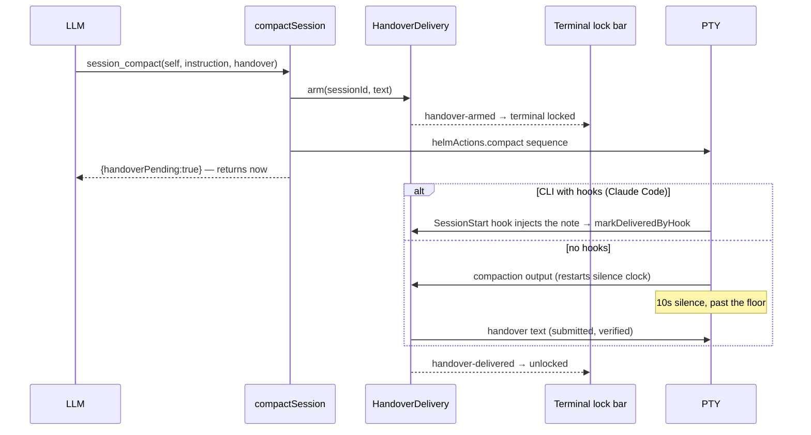
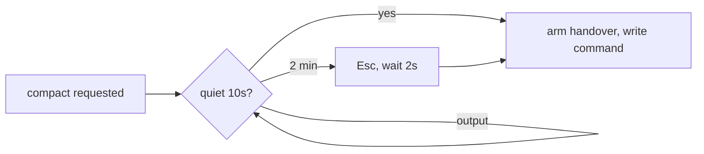
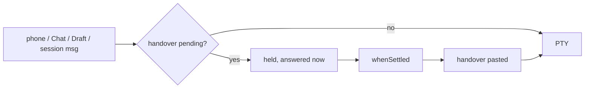

# Compaction Handover

A note a session writes to its own post-compaction self, held by Helm across the
compaction and pasted back when the session falls quiet.

## Why this exists

When a CLI compacts its own context, everything it knew goes with it. The model
that comes out the other side has a summary, not a working state: it does not
know which file it was halfway through, which approach it already ruled out, or
what the user said five minutes ago. Nothing inside the transcript can survive,
because the transcript is what is being discarded.

The fix has to live outside the context. `session_compact` therefore takes the
note *up front* — written while the context still exists — and Helm replays it
after.

The text is **opaque**. Helm never parses it, so the calling agent picks the
medium: inline prose, a file path, or an artifact reference all work equally.
That keeps Helm out of the business of deciding what a good handover looks like.

## Flow

A hook-aware CLI receives the note as SessionStart context after its
compaction or clear, so Helm settles the handover there and never pastes it —
pasting too would hand the model the same note twice.

## Never compact mid-turn

`session_compact` and `session_quick_compact` don't write their command
straight away. `HandoverDelivery.runWhenIdle` queues it until the terminal has
been quiet for 10s; if the session is still busy at the 2-minute ceiling, Helm
sends Esc to stop it, waits 2s, and compacts anyway. The tool call returns at
once, so a session compacting *itself* ends its turn first rather than waiting
on itself. A newer request replaces a queued one; closing the session drops it.
The handover is armed only when the command is finally written.

## Three decisions worth knowing

### The call returns immediately

The caller is usually *the session being compacted*. Blocking until delivery
would leave the tool call unanswered inside the very context about to be
discarded. `session_compact` returns `handoverPending: true` and the delivery
happens asynchronously.

### Armed before the command is written, never after

Arming starts the silence clock, and the compact command's own output restarts
it. Arming afterwards would start the clock late, after output it should have
seen.

### The trigger is silence, not a completion signal

The handover watches the terminal itself: 10 seconds with no PTY output, past
the floor, delivers. It deliberately ignores the session's activity state —
hook-aware sessions (e.g. Copilot) take activity from hooks only, and a
`/clear` fires no Stop hook, so that state may never change. Silence is not
proof the CLI finished. Two bounds contain that:

| Bound | Default | Guards against |
|---|---|---|
| **Floor** | 15 s | A stall *before* compaction starts, which looks identical to completion. Silence inside the window is ignored. |
| **Ceiling** | 2 min | A CLI that renders a spinner forever and never falls silent. The handover is delivered anyway — an awkward moment beats total loss. |
| **Esc retry** | quick compact only | A `/clear` whose TUI never settles (stuck menu, spinner). At the first ceiling Helm sends Esc ×3 and waits one more ceiling for silence, then pastes anyway. Never for `/compact` — Esc would abort the compaction. |

Making this exact would require parsing per-CLI "compaction complete" banner
text, which is version-fragile in a way the silence heuristic is not.

## The terminal lock

While a handover is pending, that session's terminal is read-only, like a
frozen one: a bar above it says it is compacting and offers **Send now**
(paste immediately — the user judged it ready) and **Cancel handover**. Keys aimed at it are dropped (`useTerminalKeys` and the xterm key
gate), and `pty:write` refuses user input in the main process so pastes and
IME input cannot slip past keydown. Scrolling and selection still work.

This is mechanical, not decorative: user keystrokes are PTY output, and PTY
output resets the silence timer. Idly typing into a compacting session defers
its own handover indefinitely.

It is deliberately **not a modal**. An earlier full-screen dialog locked the
whole app — no switching sessions, no Draft, no Chat — and its Esc-to-cancel
turned a stray controller B press into a lost handover. Only the one terminal
needs protecting. Cancel is a button, never a key.

## Messages wait for the handover

Anything sent to the session meanwhile — phone, desktop Chat, the Draft pane's
send, another session's `session_send_text` or `session_send_input` keys — is held by Helm and delivered
after the handover paste lands, in arrival order (`HandoverDelivery.whenSettled`).
The sender is answered at once with `deliveryStatus: 'held-for-handover'`, so a
phone never times out on a compaction that can take minutes.

Holding rather than pasting matters twice over: a paste resets the silence the
handover waits on, and during a quick compact it could land before the `/clear`
and be wiped with the old context.

## Nothing is persisted

A pending handover lives only for the minutes between the compact command and
the next lull. If Helm restarts in that window the handover is lost — but so is
the compaction that produced it, so there is nothing to restore *into*.

When a handover is dropped undelivered — user cancel, session close, or a failed
write — the user is notified. The session's whole working state was riding on
it, and the context that wrote it is already gone, so silence would be worse
than the interruption.

## Key modules

| File | Role |
|------|------|
| `src/session/handover-delivery.ts` | `HandoverDelivery` — arm, floor/ceiling, PTY-silence delivery, loss reporting |
| `src/mcp/services/helm-session-delivery-service.ts` | `compactSession` — arms then delivers the compact sequence; `offloadIfLarge` |
| `src/electron/ipc/handover-handlers.ts` | `handover:cancel` / `handover:send-now` / `handover:pending` + event forwarding |
| `renderer/composables/useHandover.ts` | Reactive mirror of pending handovers |
| `renderer/components/dock/TerminalPane.vue` | The lock bar + Cancel |
| `renderer/composables/useTerminalKeys.ts` | Drops keys aimed at the locked terminal |

`HandoverDelivery` takes its delivery and notification sinks as injected
functions, so it has no direct dependency on `PtyManager` or
`NotificationManager` and is driven entirely from a test.

## Distinct from

- **`session_clear`'s `context`** — also a note-to-future-self, but delivered on
  a fixed settle delay after a *reset*, not held across a compaction.
- **Pattern matcher schedules** — reactive to CLI *output text*; a handover is
  armed by an explicit tool call and triggered by silence.
- **Memory / context nodes** — durable and project-scoped. A handover is
  session-scoped and lives for minutes.
