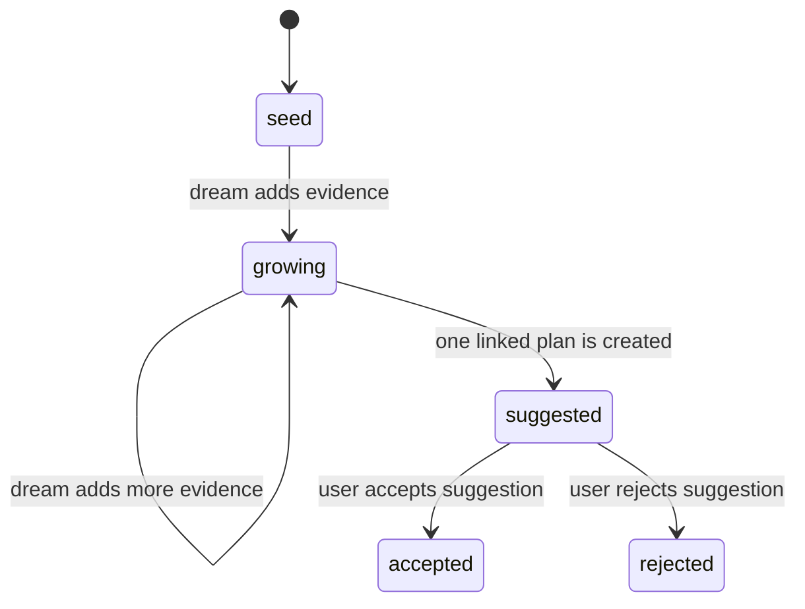

# Idea memories

An idea is a project-scoped memory for an odd, unexplained or improvable observation. It starts as a `seed`; a dream researches it and can grow it into a suggested plan. See [memory.md](memory.md#idea-memories) for how ideas are captured and kept out of normal recall.

## Dream growth

`memory_dream` gives a dream up to two ideas from its project at stages `seed` or `growing`. It orders them by `lastExpandedAt`, oldest first; an idea that has never been expanded comes first. Other sessions receive an empty `ideas` list, and ideas never appear among faded or salient memory candidates.

The dream reads each idea with `memory_get` and researches it without changing code. Useful evidence, likely cost and risks are appended to that same idea with `memory_update` and stage `growing`. A content change advances `lastExpandedAt` automatically.

For an idea worth pursuing, the dream makes one `plan_create` call with `status: "suggested"` and the idea's `sourceIdeaId`. Include these sections in the plan description:

- Problem Statement
- User POV
- Done Statement
- Files / Classes Affected
- TDD Suggestions
- Acceptance Criteria

The suggested-plan service writes the linked plan, then moves the idea to `suggested`. If a run stops after the plan is written, retrying `plan_create` returns that live suggestion and repairs the idea stage. The same idea cannot create a second live suggestion.

## User triage

The Suggestions queue owns the terminal decision. Accepting a linked suggestion moves the idea to `accepted` and makes the plan eligible for normal planning. Rejecting it moves the idea to `rejected` and removes the suggestion. Both stages are terminal; rejected ideas are also protected against similar new ideas.

Dreams do not accept or reject suggestions. They do not implement the plan or edit code.

## Watching ideas

The Memories window has a kind filter beside Regex: **Ideas** lists only idea memories, each row labelled with its stage (`idea · growing`); **Memories** lists the ordinary ones.
