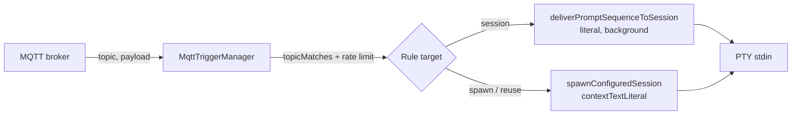

# MQTT Triggers

Helm subscribes to an MQTT broker (typically Home Assistant's Mosquitto) and turns matching messages into prompts in a session. External events such as a Timbre call question, a doorbell or a sensor reach an LLM without polling.

## Why

- **Events, not RPC.** Machine-to-machine calls between Helms go over [Fleet](fleet.md), which is paired, per-peer and request/response. MQTT is a one-to-many event bus with trust held by the broker, which suits "something happened" and nothing more. That is why it triggers prompts and never exposes tools.
- **Owner-authored rules, untrusted payloads.** Anyone who can publish to the broker controls the payload. Rule prompts come from the owner (Settings or MCP), and payload values are only ever inserted as quoted data.

## Flow

## Rules

| Field | Meaning |
|-------|---------|
| `topic` | MQTT topic filter. `+` matches one level and a final `#` matches the rest. Validated on save. |
| `prompt` | Template using `{topic}`, `{payload}` and `{payload.a.b}`. |
| `target` | `session`: an existing session id. `spawn`: a CLI type plus a configured folder. With `reuse`, the rule keeps the session it spawned (`ownSessionId`) and sends later triggers there while that session lives. |
| `minIntervalMs` | Triggers sooner than this after the last fired one are dropped. Defaults to 5000. |
| `enabled` | Disabled rules are not subscribed to. |

Messages that no enabled rule matches are ignored. Every trigger, drop and failure is logged under `[MqttTrigger]`.

## Untrusted payload containment

1. Each payload value, and the topic (the publisher controls its wildcard levels), is rendered as a JSON string literal (`"..."`), so quotes and newlines are escaped and the value cannot break out of its quotes. Values are capped at 4,000 characters, and payload paths only follow the payload's own keys.
2. When any payload value is used, the prompt ends with a note telling the LLM that quoted values are untrusted data.
3. Delivery is **literal**: every brace is doubled before the [sequence parser](config-system.md) runs, so a payload such as `{Ctrl+C}{Enter}` is typed as text and never becomes keys. The same flag (`contextTextLiteral`) covers the spawn path's first prompt.

## Surfaces

- **Settings → Connections → MQTT triggers:** broker URL, username and password, connection status, plus the rule list and an "Add rule" form. The password is write-only: the renderer only learns `hasPassword`.
- **MCP:** `mqtt_rule_create` (target `targetSession:"caller"`, `sessionId`, or `cliType` + `dirPath`), `mqtt_rule_list` and `mqtt_rule_delete`. Spawn folders pass the same working-directory gate as every other spawn. `mqtt_rule_create` and `mqtt_rule_delete` are hard-denied to Fleet peers and phones, because a rule has an owner-trusted template and outlives a revoked caller.

## Storage and lifetime

Rules and broker config are per user profile, stored in `mqtt-triggers.yaml` in the profile config dir. Rate-limit state (`lastFiredAt`) is runtime-only. The connection starts with the scheduler after startup and is off until the broker is enabled. It reconnects every 5 seconds after a drop.

## Key modules

| Module | Role |
|--------|------|
| `src/session/mqtt-trigger.ts` | Pure helpers: `topicMatches`, `assertTopicFilter`, `renderTriggerPrompt` |
| `src/session/mqtt-trigger-manager.ts` | Broker client, subscriptions, rules, rate limit, dispatch to injected deliver/spawn |
| `src/session/mqtt-trigger-persistence.ts` | YAML load/save |
| `src/electron/ipc/mqtt-handlers.ts` | `mqtt:*` IPC and `mqtt:changed` push |
| `renderer/components/settings/pages/MqttTab.vue` | Settings page |
