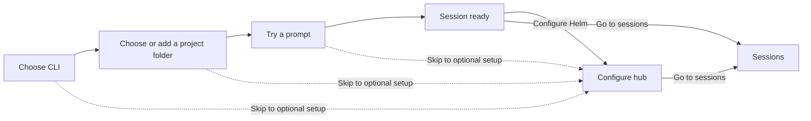

# First-run onboarding

The wizard gets a new user to a working session before asking them to configure the rest of Helm. The Configure hub keeps optional setup discoverable without duplicating settings forms.

## Flow

The first three steps offer a configured CLI, a project folder, and an editable starter prompt. A successful spawn reaches **Session ready**; Configure Helm opens the optional hub.

## Configure hub

The workspace guide has one row each for **Draft**, **Mission bar**, **Artifacts**, **Mess**, **Statistics** (Timesheet and Tokens), **Plans**, **Memory**, and **Freeze**. The first seven open their dock panes; Mission bar opens Terminal, where it lives. Freeze is a session action, so its row is informational.

Setting topics open existing pages and are grouped under **Agent setup**, **Workflows**, **Connect**, and **Helm**.

## Trigger and persistence

The app checks `onboardingCompleted` during startup. A fresh install defaults it to `false`, so the wizard opens automatically. Starting a session successfully, choosing optional setup, or finishing saves it as `true`. An older settings file without the field is migrated as complete, so an upgrade does not reopen first-run onboarding.

## Adding a topic or workspace row

- Add a setting topic to `ONBOARDING_SETTING_GROUPS` in `renderer/onboarding-settings-topics.ts`; use an existing Settings page id for `tabId`.
- Add a `WorkspaceGuideItem` to `WORKSPACE_GUIDE` in `renderer/components/modals/FirstRunOnboarding.vue`. Set `paneId` to an existing dock pane to make the row open it; omit `paneId` for an informational row.
