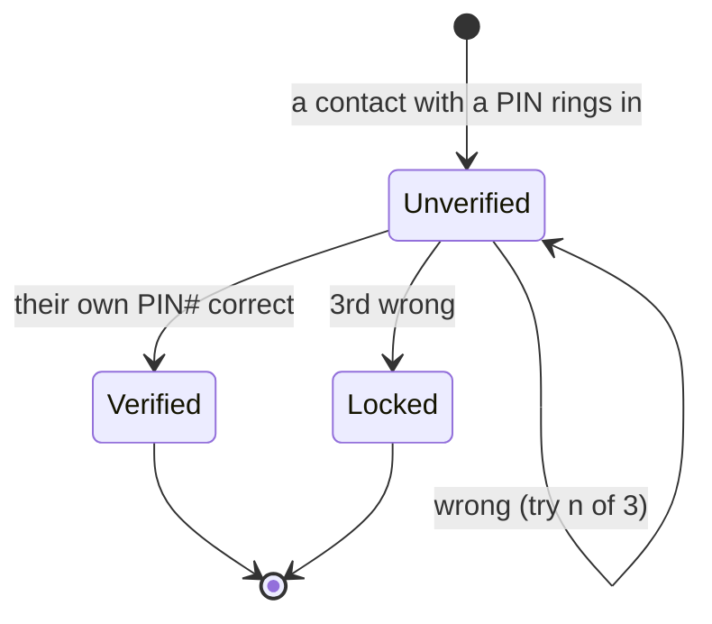
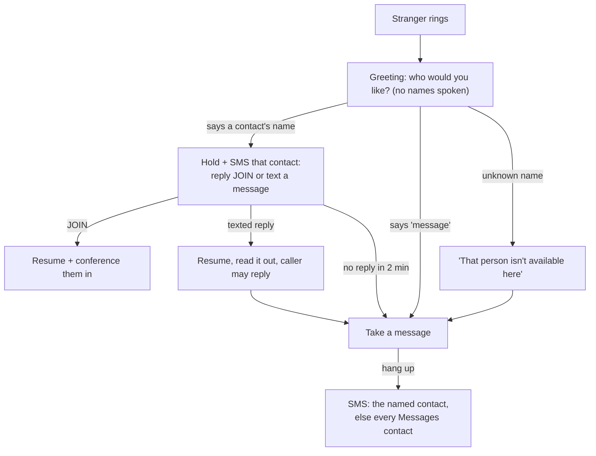
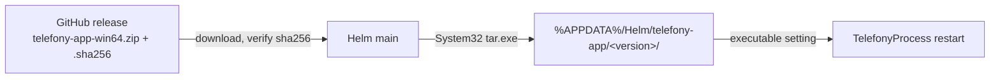

# Phone line (telefony-app over PhAP)

A real phone line for Helm. [telefony-app](../../telefony-app) turns the PC into a Bluetooth hands-free kit for the user's phone. It speaks [PhAP 2026-10-27](../../phone-agent-protocol/spec/2026-10-27/index.md): JSON-RPC over `ws://127.0.0.1:<port>/phap`. Helm connects to it as the **controller**.

| What | Behaviour |
|---|---|
| Inbound call from an allowed number | Helm answers. telefony speaks the greeting. The caller's speech goes to the **operator** as `[PHONE]` lines. The operator's `chat_send` is spoken into the call. |
| Inbound SMS from an allowed number | Delivered to the operator as `[PHONE SMS]`. The operator's next `chat_send` (within 30 min) is sent back by SMS. |
| `ring_user` while the Helm phone app is offline | Helm dials the owner and greets them with the reason. The call is then routed to the ringing session. If unanswered, the reason goes by SMS. |
| `notify_user` while the phone app is offline | Texts the owner. **Off by default**, because notifications are frequent. |
| `call_transfer` | Moves the phone-line call to another session, the same as for the Helm phone app. |
| `phone_hangup` / `phone_conference_add` / `phone_sms_inbox` | MCP tools for the session holding the call, or any session for the inbox. |

Settings live in Settings → Connections → **Phone line** (the `phoneLine` key in `settings.yaml`).

```mermaid
flowchart LR
  S[Settings > Phone line] -->|settings.yaml phoneLine| H[PhoneLineService]
  H -->|writes telefony.toml + spawns + watchdog| T[telefony-app]
  Phone((Phone)) <-->|Bluetooth HFP/MAP| T
  T <-->|PhAP ws JSON-RPC| C[PhapClient]
  C --> B[PhoneBridge]
  B -->|decide()| B
  B -->|"[PHONE] lines"| Op[Operator session]
  Op -->|chat_send via ChatBroker| B
  B -->|call.say / sms.send| T
  Op -->|call_transfer| W[Other session]
```

## Why Helm owns telefony-app

telefony reads its TOML once at startup, and PhAP cannot change it. To keep one source of truth, Helm writes `<config>/telefony/telefony.toml` from its own settings and launches `telefony-app <toml>`.

When a field that telefony reads changes, telefony restarts. The restart **never happens under a live call**: it waits until the call ends, and the status shows "Waiting for the call to end". Persona, transcripts and per-action rules apply live, with no restart.

The watchdog restarts telefony when it exits, and when the PhAP socket goes silent for 3 × the heartbeat interval. Restarts use backoff from 1s to 60s and give up after 10 attempts. The counter resets after a minute of stable uptime.

The PhAP token is generated on first enable and written to both sides. The user never types it.

## Permissions: two layers

1. **telefony's policy** is generated with `outbound = "all"`: telefony dials any well-formed number and Helm alone decides. The `allowlist` (every exact, non-blocked number with a switch on) is still written for telefony's own admin view.
2. **`decide(action, number, cfg, ctx)`** (`src/phone/phone-config.ts`) gates every action in Helm, in this order:
   1. the master switch for the action
   2. withheld or invalid numbers: deny
   3. any matching **blocked** entry: deny
   4. the most specific match, with its per-action switch (`callIn` `callOut` `smsIn` `smsOut` `conf`)
   5. outbound only: the **cost guard**, then quiet hours (an urgent owner ring passes), hourly limits, conference size

**Cost guard.** International numbers (outside `countryCode`, or typed with the `0011` exit prefix) and premium numbers (19xx in Australia, built in) plus any `limits.blockedPrefixes` are refused for every outbound action, **owner included**: a talked-into-it assistant must never run up a bill. Side effect: Australian service numbers typed without their area digit (`1300…`, `1800…`) read as `+1…` and are blocked. Premium ranges are only known for Australia, so any `countryCode` other than `+61` blocks every outbound action (fail closed).

**Dial-out for a caller.** `decideDialOut` lets a PIN-verified caller (the owner, or a trusted contact who keyed their PIN) have Helm dial *any* domestic number: master `callOut`, verified, cost guard, blocked entries, then the hourly call cap (default 3).

Unlisted inbound callers are not denied: they go to Reception (below). Unlisted SMS go to the owner only.

Every decision is logged and shown in the status log.

**Roles.**
- `owner` drives the operator, receives fallback rings and texts, and is the only one who can grow a call into a conference.
- `trusted` callers reach the operator in "take a message" mode. This is a prompt-level restriction, not a tool gate.
- `messages` (a per-contact switch) receives messages strangers leave without naming anyone. Rows saved before it existed: the owner is on.
- `blocked` overrides everything.

**Privacy.**
- Sessions see contact labels, never digits.
- Caller speech and SMS bodies are JSON-quoted as third-party content.
- `phone_sms_inbox` honours the read scope: nothing, only SMS Helm received, the last N minutes, or everything. It also masks 4–8 digit codes.

## Keypad PINs

Caller ID is spoofable, so each contact (owner or trusted) may have a keypad
PIN (`pin`, 4-12 digits). An inbound call keys it and ends with `#`; dial it in
one go as `number,PIN#` (`,` pauses about 2 s on Android). Until then the owner
number is a guest (briefing "unverified", message only, no conference) and a
trusted caller is unverified (no dial-out). The old single `ownerPin` setting
migrates onto the owner row.



- A trusted contact's PIN verifies *them*; it never grants owner rights.
- Digits come from telefony's `call.dtmf` events; they are never logged,
  delivered to a session, or written to a transcript. Comparison is
  constant-time.
- Calls Helm dials itself (ring_user) reached the real number, so they need no PIN.
- A malformed PIN resolves to blank, i.e. caller ID only.

## Reception: callers not in the list

Anyone not listed (withheld included) is answered by **plain code**
(`src/phone/phone-reception.ts`), never a model: under the isolation model a
stranger's words must not reach anything holding tools. Their speech is only
word-matched against contact labels, and messages go by SMS to people.



- Matching: the full label, or its first word if only one contact has it. Ambiguous means no match, never the wrong person.
- Each texted contact needs `smsOut` on, and `smsIn` (plus the master) for their JOIN or reply to be read; otherwise the caller falls through to a message.
- A stranger SMS (a one-time code, say) is forwarded to the owner only, and counts toward the hourly SMS cap.

## Installing telefony-app

The Phone line page has an **Install / Update** button. telefony-app is
Python, so it is not bundled in the Helm installer: that would bloat every
install with onnxruntime/whisper and freeze the version. Instead each
telefony-app `vX.Y.Z` GitHub release carries a PyInstaller onedir build:



- Versions install side by side; old ones are pruned only after the new one
  is configured, so a failed update leaves the working install alone.
- The zip's `telefony-app/piper/` folder must stay beside the exe (Piper is a
  separate GPL program, found there without PATH).
- The renderer never passes a URL; main re-resolves the latest release and
  accepts only assets under the telefony-app repo's release downloads.
- Speech-to-text defaults off: faster-whisper downloads its model (~500 MB
  for `small.en`) to the Hugging Face cache on first use.

## Transcripts

When a call ends, Helm asks telefony for `transcript.get`. It writes Markdown and/or JSON to the configured folder, or `<config>/phone-transcripts` if none is set. File names use `{yyyy} {mm} {dd} {HHmm} {label} {direction}`, and the path is confined to that folder. Files carry a `helm-phone-transcript` marker.

The daily retention sweep deletes only marked files, so pointing the folder at a notes vault is safe. Audio is not recorded.

## Limits (v1)

- One call at a time, which is telefony's v0.1 limit. A second inbound call is left to the phone.
- Reception's JOIN/reply arrives through the 30 s SMS poll, so a held caller may wait up to that long.
- telefony's Bluetooth MAP does not push `sms.received` yet, so Helm polls `sms.list` every 30s. The inbox present at connect time is treated as history.
- If the operator is off, inbound calls are left to ring on the phone (telefony's fallback policy applies).
- telefony's web admin API (`/api/config`, port 7782) can apply allowlist changes live. Helm does not use it yet; it restarts instead.

## Code

| File | Role |
|---|---|
| `src/phone/phone-config.ts` | Settings shape and defaults, `decide()`, `decideDialOut()`, cost guard, number normalisation, templates |
| `src/phone/phone-reception.ts` | Plain-code answering for callers not in the list: name match, hold + ask, messages |
| `src/phone/telefony-installer.ts` | Install / update telefony-app from its GitHub release: checksum, side-by-side versions, prune |
| `src/phone/telefony-process.ts` | TOML render, spawn, watchdog |
| `src/phone/phap-client.ts` | PhAP controller client: hello, events, heartbeat, resume |
| `src/phone/phone-bridge.ts` | Routing, the ChatBridge, ring/transfer/conference/inbox, transcripts |
| `src/phone/phone-line-service.ts` | Composition, apply/restart rules. This is what main wires in. |
| `src/electron/ipc/phone-handlers.ts` | `phone:*` IPC |
| `renderer/components/settings/pages/PhoneLineTab.vue` | Settings page |

Tests run against a real WebSocket fake PhAP server (`tests/helpers/fake-phap-server.ts`) and a real child process.
