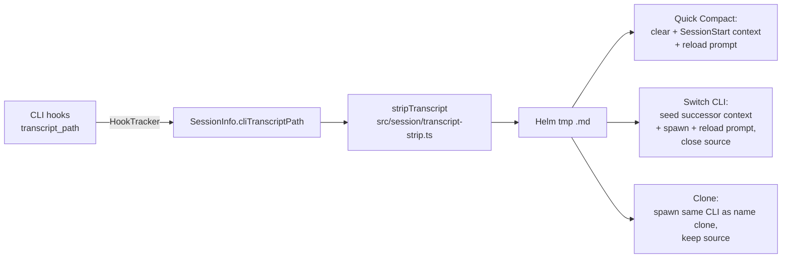

# Quick Compact, Switch CLI & Clone

Three actions share one engine: Helm strips a session's own transcript to markdown and has a fresh context read it back.

- **Quick Compact** (`session_quick_compact`, context menu "🗜️ Quick Compact"): strip → clear the session → run the CLI's configured initial-prompt sequence → paste a prompt pointing at the file. The clear's SessionStart hook re-injects manifesto, mission, todos and active plan through the existing context builder. The shared reload scheduler sends the transcript pointer once the configured sequence finishes. `session_clear` notes use the handover idle-wait ([handover.md](handover.md)).
- **A redundant compaction is answered as done**: if the context is green and something compacted it in the last 5 minutes, `session_quick_compact` and `session_compact` do nothing and reply as if they had compacted. That covers the CLI's own compaction (PreCompact hook) and Helm's (both tools stamp `lastCliCompactAt` once their command is delivered), and every caller: agent, desktop menu, phone, scheduler. The case it stops: a resumed agent re-reads its own "compact me" turn in the transcript and asks again — Codex did, compacting twice. A context reading older than the compaction is stale and counts as green; amber or red compacts normally. A request that arrives while another compaction still waits for the session to go idle is answered the same way.
- **Quick Compact interrupts first**: it sends the CLI's `helmActions.stop` sequence (CLI settings › Helm actions › Stop, sequence syntax) to cancel a turn and unwedge a half-typed composer before the `/clear`. Blank falls back to an even Esc burst — pairs so Esc-Esc toggles cancel out.
- **Quick Compact leaves a snapshot**: just before its `/clear`, it composes the same **Compaction snapshot** artifact as a CLI compaction (stripped transcript inline, raw transcript attached). A `/clear` fires no PreCompact, so without this a Quick Compact left none.

```mermaid
graph TD
  R[compaction request] --> G{one already pending, or<br/>compacted &lt;5 min ago and context green?}
  G -->|yes| D[reply: done — nothing sent]
  G -->|no| S[snapshot artifact] --> C[/clear + resume prompt]
  C --> T[stamp lastCliCompactAt]
```

- On the phone, all three sit on the session sheet: "Quick compact" (confirms first), "Switch CLI" (opens a picker of the desktop's CLIs) and "Clone". Rows grey out unless the device's mobile allow-list permits the tool.
- **Switch CLI** (`session_switch_cli`, context menu "🔀 Switch CLI…" → CLI picker): strip → seed the successor's SessionStart context → spawn the picked CLI in the same directory, name and runtime group with the transcript pointer as its reload prompt → close the source (recycle bin, restorable; `closeSource: false` keeps it; locked sessions are never closed). A replacement receives the mission and todos, and takes over the active plan claim. A failed spawn rolls back those copies and the claim.
- If the successor fails to start, restore the source session from the recycle bin; its data is retained.
- **Artifacts follow** (Switch CLI and Clone): before the successor process starts, every artifact is copied under a fresh id, with its versions and attachments. The source keeps its own. A copy's content has the old artifact id swapped for the new one, so embedded attachment paths point at the copy's files. This makes manifestos available to the first SessionStart hook.
- **Clone** (`session_clone`, context menu "🧬 Clone" → CLI picker): spawn with the picked CLI; MCP callers may pass optional `cliType`, which defaults to the source CLI. The clone is named "<name> (clone)" and the source stays open. Plans, mission and todos are not transferred.



## Why strip instead of `/compact`

Measured on a 157k-token Claude Code session: `/compact` landed at 47–56k, a local-model fold at 56k, stripping at 62k. Only the stripped copy answered every recall question exactly — summaries lose paths, numbers and decisions. Stripping costs ~10–15k more context and no model call.

What is kept: every user prompt and assistant reply, one line per tool call (name + clipped arguments), and failed tool results. What goes: thinking (only useful inside the turn that produced it), successful tool output (re-readable from disk), meta records and injected hook text. Helm plumbing is removed too — `[HELM_MSG]` envelopes and reply directives, `[HELM_*_RULES]`/`_MODE` blocks, mission/mess/suggestion lines, Stop-hook feedback and large-text temp-file pointers — keeping only the message body: it names the old session's ids, and a successor that reads it back replies to a dead session. Claude Code logs start from the last compaction boundary, keeping its summary; Codex rollouts read `response_item` records only and keep the whole history across compactions — Codex's `compacted` summary is encrypted, so the earlier turns are the only readable record. Copilot CLI logs start after the last `session.compaction_complete`, keeping its summary; sub-agent records (`parentToolCallId`) and the injected `transformedContent` are dropped.

## Requirements

- **CLI hooks installed** ([cli-hooks.md](cli-hooks.md)). The transcript path only arrives through hook payloads (Copilot sends none, so it is derived from the hook's `sessionId`: `~/.copilot/session-state/<id>/events.jsonl`) and is persisted on the session, so it survives a restart. Without it both actions refuse with a clear error and change nothing.
- Supported log formats: Claude Code, Codex and Copilot CLI JSONL. Other CLIs fall through to the Claude parser and produce an empty strip.
- Every strip logs `[TranscriptStrip]` (format, source, sizes, record/compaction/section counts, output file); an empty strip warns with the log's record-type histogram. `[HookTracker]` logs each newly learned transcript path.
- No size limit: the log is read in 16 MB chunks, so it may exceed V8's ~512 MB string cap. A 725 MB Copilot log strips in ~2 s at ~1.6 GB peak memory.
