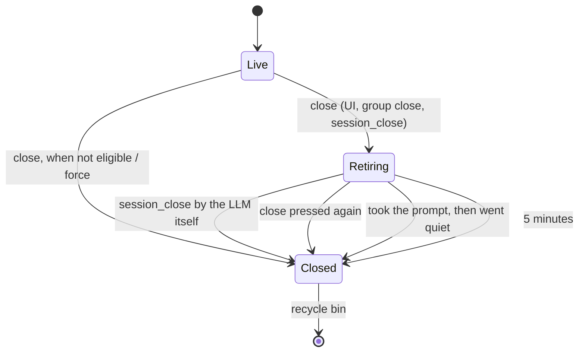

# Save memories on close

Closing a CLI session first gives its LLM a chance to save what it learned as
Helm memories. Without this, everything a session found out is lost when it
closes, unless someone remembered to save it beforehand.

## Flow

`SessionRetirer` (`src/session/session-retirer.ts`) owns this. `HelmSessionService.closeSession`
is the only way a user or an LLM closes a session. The desktop `session:close` IPC, the
renderer's group close (which closes each member) and the MCP `session_close` tool all go
through it. Helm's own closes (switch CLI, force restart) call `hardCloseSession` and skip this step.

While retiring:

- The session keeps `retiringAt` (runtime only, not persisted). After a restart it comes back as a normal row.
- The desktop row is hatched like a frozen one and has a big X across it. The session is **not**
  frozen, because frozen refuses all stdin and the prompt could not land.
- It is left out of `session_list`, so the phone and other LLMs no longer see it.
- `session_close` replies `closing: true`. A second close, or `force: true`, closes it at once.

## When it applies

Every close does this unless one of these is true, in which case the session closes at once:

- its CLI type turned off **Save memories on close** (`saveMemoriesOnClose: false` in `cli-types.yaml`; on by default)
- it is an API tool, a ComfyUI tool or a remote row
- it is frozen
- it was never prompted, so it has nothing to remember
- the prompt could not be delivered

## The prompt

This is the `closeSaveMemories` hook injection (Settings → hook injections, group "Session close"),
so it can be edited. It is sent through the normal prompt-delivery path. By default it asks the LLM to
`memory_search`, then `memory_create`/`memory_update` anything lasting, and finally call
`session_close` on its own session.

"Went quiet" means a prompt landed after the close started (`lastPromptAt >= retiringAt`) and the
activity dot then left green. Without hooks, `lastPromptAt` only moves on desktop Enter, so a
hookless session waits out the 5-minute timeout.
