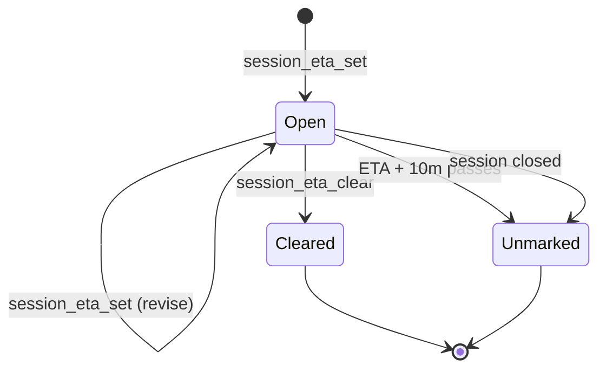

# Session ETA

The session's LLM can set an expected finish time for its current multi-step
request. Helm does not change the ETA it sets, but it scores every estimate
against when the work actually finished and learns a confidence range from that
history.

## MCP tools

`session_eta_set` acts only on the authenticated caller's own session. Supply
exactly one of:

```text
session_eta_set(minutes=25, note="review tests")
session_eta_set(at=1792288800000, note="finish handoff")
```

`minutes` is a positive number from now. `at` is an absolute epoch-millisecond
timestamp in the machine's clock; a past time is accepted and appears overdue.
The optional note is trimmed. Setting a new ETA replaces the previous one.

`session_eta_clear()` removes the estimate. Both changes persist with the
session and are returned as `your_eta` by `session_info` and as `eta` by
`session_get`, `session_list`, and session-list deltas. The record contains
`at`, `setAt`, and an optional `note`.

## Desktop row

The desktop session row shows `🏁 HH:MM` in local time, followed by `(~N)` once
the estimate carries a learned range (N = half the range, in minutes). Its tooltip includes the
ETA, time remaining, the 80% range (or "no range yet"), set time, and optional
note. After the ETA passes, the row
shows `🏁 late Nm` in warning amber. It uses the existing elapsed-timer tick.

The hook places one `[HELM_ETA]` reminder beside `[HELM_TODOS]`, asking the LLM
to set and update its estimate when it takes on multi-step work, and to call
`session_eta_clear` the moment the work is done. The phone has
no ETA display.

## Accuracy and confidence range

Each estimate is scored when it closes (`src/session/eta-tracker.ts`) and
appended to `estimates.jsonl` in the time-tracking dir.



- **Re-setting never restarts the clock.** The actual time runs from the first
  set to the clear and is scored against the *first* guess, so re-setting a
  tiny ETA over and over only shows as late. A re-set moves the shown time.
- **Unmarked**: not cleared by ETA + 10m (a 1-minute sweep), or the session was
  closed with an estimate open. Its end is capped at ETA + 10m. A clear that
  arrives after that cap also counts as unmarked.
- **Learning** uses only cleared estimates whose first guess was 5m or more,
  for the same CLI type **and** folder, newest 50. With 5+ samples, the P10–P90
  of actual ÷ predicted is scaled onto each new estimate and stored on it as
  `range {lo, hi, samples}` — so it persists, reaches `session_info`, and needs
  no renderer arithmetic.

## Statistics → Estimates

The Statistics pane's third tab (`EstimatesView.vue`) shares the period and
anchor with Timesheet/Tokens and adds a folder filter: tiles (on-time % against
the first guess, median slip, count, unmarked), a predicted-vs-actual scatter
coloured by CLI with unmarked as amber rings, an actual ÷ predicted histogram,
an on-time % trend per period column, and the 30 most recent estimates. The
data comes from `time:estimates` (also `view: 'estimates'` on the phone's
statistics route); see `src/session/eta-stats.ts`.
