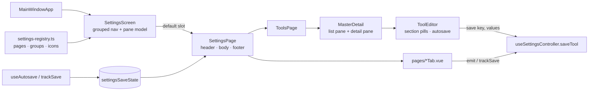

# Settings screen

Settings takes over the whole main window: a grouped nav on the left and the selected page on the right. Every edit saves itself, so no page has a Save button.

## Structure

| Piece | File | Role |
|---|---|---|
| Registry | `renderer/components/settings/settings-registry.ts` | The one list of pages: id, label, group, icon. It also maps legacy persisted tab ids. Nav order is list order. |
| Screen | `renderer/components/settings/SettingsScreen.vue` | Renders the grouped nav and owns gamepad input inside settings. |
| Page frame | `primitives/SettingsPage.vue` | Header, body and footer. The footer carries the key hints and the save status. `flush` hands the body to a page that lays out its own panes. |
| Primitives | `primitives/MasterDetail.vue`, `PillTabs.vue`, `SettingsCard.vue`, `FieldRow.vue` | Shared shells for list/detail pages, sub-tabs, cards and label/control rows. |
| Tools | `tools/ToolsPage.vue`, `tools/ToolEditor.vue` | The CLI type list plus an inline editor. |
| Pages | `pages/*.vue` | The other pages, unchanged in logic and restyled through shared CSS. |

Nav groups:
- **Sessions:** Tools, Session list, Bindings, Chip actions.
- **Knowledge:** Projects, Skills, Auto memory.
- **Connections:** Telegram, Mobile, Fleet, MCP server, CLI integrations.
- **System:** Operator, Voice, Updates, Scheduled tasks.

## Layout

The settings body uses the available page width. List and form pages keep a single vertical column for a clear reading order; pages with independent cards use the shared `.settings-sections` grid, which auto-fits columns at `minmax(520px, 1fr)`. `.settings-span` lets wide tables, lists, and long prompts use the full row. Intentional master-detail panes keep their own split.

## Gamepad

Pages register with the screen through provide/inject (`settings-panes.ts`), not per-page wiring. The panes are the nav plus every innermost `SettingsPane` the page renders, left to right. A page opts in by wrapping its columns in `SettingsPane`, and a nested pane splits its parent into columns (as Skills does).

| Button | Effect |
|---|---|
| ◀ ▶ | Previous / next pane. Re-entering a pane restores the item last focused there. |
| ▲ ▼ | In the nav: switch page. In a pane: move focus within it. |
| A | In the nav: enter the first pane. In a pane: activate the focused item. |
| B | Back one pane. From the nav, close settings. |
| LB / RB | Previous / next sub-tab: `PillTabs` and the Skills tabs register via `useSettingsSubTabs`. |

Keyboard arrows are left alone while a text field has focus. `useInputRouter` forwards every settings button except Guide/Sandwich to `SettingsScreen.handleButton`, so one place decides navigation.

## Save model

- `useAutosave(save, { debounceMs })` debounces bursts of edits into one save (500 ms by default).
  - An edit made during an in-flight save triggers exactly one follow-up save.
  - A pending edit is flushed when its owner unmounts, so leaving a page never drops it.
- `trackSave(fn)` reports a save the page performs itself (a toggle, or an emit the controller handles) on the same status.
- Both write `settingsSaveState`, which the page footer renders as Saving… / Saved / the error.
- **Add creates immediately.** "+ Add" and Clone write the new CLI type with a unique name and select it.
- **Destructive actions confirm.** Delete asks a second time in place.
- **Validation blocks only the bad edit.** A clashing display name or bad context limits shows inline and is not written. The rest of the form stays editable.
- **The operator rules debounce for 1.5 s and save on blur**, because every operator save re-runs `ensure()`.
- **Creating a scheduled task keeps its explicit Create button.** A task needs a schedule and a prompt before it can exist.

`ToolEditor` remembers which tool the form holds (`formKey`). On a selection change it flushes the pending edit to the old tool before loading the new one.

## Visual rules

- Selected or active items use a tinted fill (`--accent-tint`) with accent text: nav items, list rows, pills, chips.
- There is never a coloured edge bar.
- Gamepad focus is a separate inset ring (`--focus-ring`). Switches get an outer ring.
- Checkboxes in settings render as switches (shared CSS in `main.css`). The API tool tick list keeps plain boxes.
- Line SVG icons only. No emoji in nav or labels.
