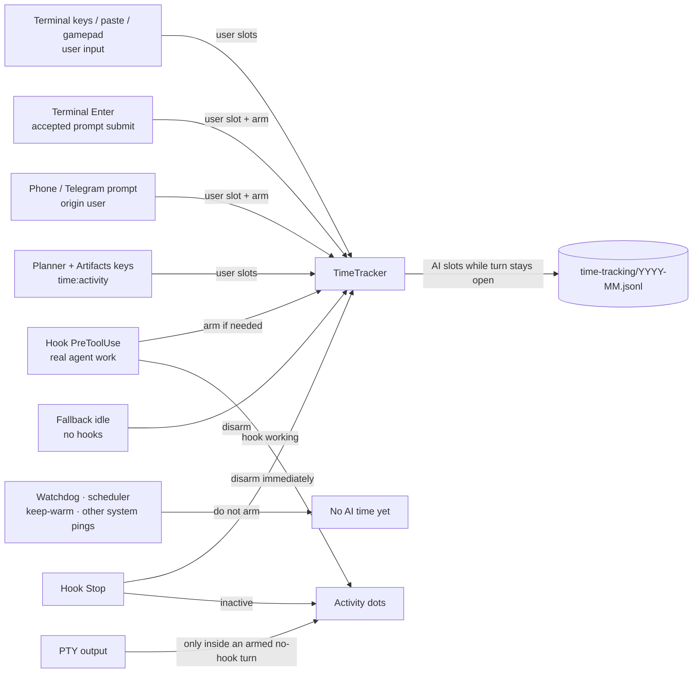
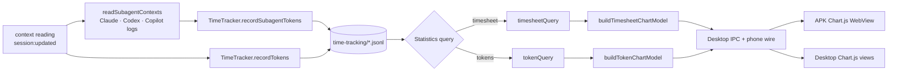
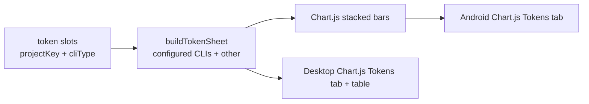

# Time Tracking

How long the user worked on each project, shown as a timesheet per folder.

## Why slots

Measuring the user's own time means guessing at the gaps between inputs. A fixed 5-minute grid makes the guess explicit and cheap. A slot counts if the user did anything in it, and idle slots count nothing. Several inputs inside one slot are still one slot.

## What counts

- **You** (`user` slots): input the user produced: keystrokes in the terminal, planner or artifacts, and on the phone any message or action that changes something. Read-only phone calls (`*_get`, `*_list`, `*_read_terminal`, …) do not count, and neither does reading a terminal.
- **Noise floor**: a project needs `SUBMIT_WEIGHT` (20) input in a slot to earn it. A keystroke weighs 1. A submit (Enter, a phone or Telegram message including speech-to-text, a phone edit) weighs the full 20, so one deliberate send always counts and a few stray keys never do.
- **What never counts:** Programmatic sends (background deliveries, AI-to-AI `session_send_text`, the scheduler, initial prompts) are `system` origin and never count.
- **One project per user slot.** If the user touches two projects in one slot, the one with more input wins, and a tie goes to the latest. Within that project, the folder with the most input gets the slot.
- **AI** (`ai` slots): a user-originated prompt arms a turn; real hook-reported work (`PreToolUse`) can arm one after a system prompt. The turn earns AI slots until a hook `Stop`, or until the fallback idle for a session without hooks. Watchdog, scheduler, keep-warm, and other system prompts do not arm time or turn a dot green. If a hook later proves real work, that work counts. TUI repaint output cannot reopen a turn or keep an idle session green. Agents genuinely run in parallel, so AI slots are per project, not exclusive.
- **Tokens** (`tokens` slots): every context-size reading a session reports (statusline, transcript, or API loop; see [terminal-architecture](terminal-architecture.md)) feeds a per-session ledger. A rise adds the growth. A drop (compact, `/clear`, quick compact) adds the new, smaller context, because the CLI re-read that much. So 199k → compact → 50k counts 249k. Each stream's last reading is saved beside the ledger (`token-baselines.json`, written every tick and at shutdown), so growth while Helm was down still counts and a sub-agent that started meanwhile counts in full. Only an install with no saved baselines yet treats a session's first read as a baseline, so nothing is counted twice. A reading that cannot be placed (no working directory) leaves the baseline alone. Tokens are summed per project, CLI type, and directory per slot; the Tokens tab aggregates them per CLI. Every CLI type that reports its context size counts. Remote (peer) rows are skipped, since their own machine counts them.
- **Sub-agent tokens**: a sub-agent's work never shows in the main context, so its logs are read too (`subagent-usage.ts`). Claude writes one file per sub-agent in `<session>/subagents/`. A Codex sub-agent gets its own rollout file in the same folder, naming the parent in `parent_thread_id`. Copilot tags sub-agent `usage_record` lines in the parent's `events.jsonl` with an `agentId`. Each sub-agent is its own ledger stream with a zero baseline, so its whole context counts, then only its growth. The logs are swept every minute (`SubagentTokenIngest`), once more when a session closes and at shutdown, whether or not the main context moved. Every read is a delta against the stream's last reading, so sweeping often never counts anything twice. A tail with no usage line (a long stretch of tool output) is widened until one is found.
- **Project** = the session's Helm project, or its working directory when it has none.
- **Keys** (`keys` slots): the desktop keyboard router counts each non-repeat keydown once for the active session's project, including shortcuts. Pasted characters and phone input add no keys; Ctrl+V itself is one keypress. Counts are independent of the user-time noise floor and CLI type.

## Storage

Append-only JSONL, one file per local month under the app-data `time-tracking/` dir (config boundary). Each line is one closed slot `{start, kind, projectKey, projectName, dir}`, plus `tokens` and `cliType` on `kind: 'tokens'`, or `keys` on `kind: 'keys'` (slots written before `cliType` existed have none). The open slot is written once it ends, or on shutdown. A corrupt line is skipped. A slot written at shutdown and reopened after a restart is deduplicated on read. For time the later record wins, because a slot is presence. Token records are deduplicated per project, CLI, and directory, then summed as disjoint partial counts. Key records are deduplicated per project and slot, then summed. Appending survives crashes without a native DB dependency.

## Statistics pane

Dock pane **Statistics** (📊, shortcut `l`) has tabs that share the period toggle and ◀ ▶ stepping. The **Timesheet** tab starts with totals for every project in the selected period, like the Android Statistics screen. Choose a project to drill into its folder rows; Back returns to the project list. The selected session never changes the timesheet scope. Project totals are ordered by user time, then AI time, then project name. The views are:

| View  | Columns |
|-------|---------|
| Hour  | the 24 hours of a day |
| Day   | the 7 days of a Monday week |
| Week  | the Monday weeks covering a month |
| Month | the 12 months of a year |

A Chart.js chart sits above the table in both views. *You* and *AI* minutes are bars on the left axis, and tokens are a line on the right axis. The chart legend toggles each series, and the token axis hides with its series. The plot ends at the current column: periods that have not started yet are not drawn. The project totals chart covers every project.

The main process builds a transport-neutral `ChartModel` from the same sheet used by the table. It contains column timestamps and labels plus keyed series with type, axis kind, colour and raw values. Values stay unstacked so a chart client can stack and rescale only visible series. Desktop renders that model with Chart.js: Tokens stacks the visible CLI series, and Timesheet combines grouped *You* and *AI* bars with a token line on a second axis. Axis, grid and tooltip colours come from app CSS tokens. Android renders the same model with the locally bundled Chart.js 4.5.1 UMD build inside `ContainedWebView`; it makes no network requests. Its horizontally scrollable legend uses 48px touch targets, and toggling a series restacks and rescales the visible data. Tooltip counts use the full value rather than compact axis notation. Older desktop replies without `ChartModel` still parse, but do not include a chart. Each folder cell shows *You* time, with an *AI* line and a *Tokens* line underneath when nonzero. The project overview shows each project's *You*, *AI*, combined and *Tokens* totals. The arrows page the selected period, and the range label jumps back to now. **CSV** is available in project detail and exports that project's current view (`period_start,project,directory,you_minutes,ai_minutes,tokens`).

### Keys tab

Desktop keydowns are batched by session and five-minute slot, then stored as project counts. The Keys tab shows project rows with counts and totals across the selected hours, days, weeks, or months. It records no key names or text. The tab is desktop-only; the phone statistics route can query the same counts but phone typing does not contribute.

### Tokens tab

Tokens per CLI per column: one row per configured CLI type, labelled by its display name, in config order and zero-filled, so an unused CLI still shows. Slots with no `cliType`, or from a CLI type no longer configured, share one trailing **other** row. Sub-agent tokens count toward the parent session's CLI. `buildTokenChartModel` drops series that are zero in the visible columns and keeps each remaining series' values unstacked. Its key-based colour is unique within a chart and stable across row order. Desktop and Android legends hide series, then Chart.js restacks and rescales the visible values. Android's table swatches use the same keyed chart colours. A tooltip shows the column label, CLI, and exact token count.

All arithmetic (`periodEdges`, `buildTimesheet`, `buildTokenSheet`, `summarizeProjects`, `timesheetToCsv`) lives in `src/session/time-tracker.ts`. The shared chart builders live in `src/session/chart-model.ts`; queries send the model with the sheet over desktop IPC and the phone wire. The phone uses the reserved, read-only `__timesheet__` method with `view: "timesheet"` or `view: "tokens"`; omitting `view` keeps older phones on the existing timesheet shape. The mobile gate remains unchanged. Its handler routes to the same `timesheetQuery` and `tokenQuery` functions used by desktop IPC, so the ledger and chart are not duplicated. No chart markup or executable code crosses either transport.

A saved dock layout from before a pane existed keeps its arrangement, and the new pane is offered as closed in the View menu (`dock-persistence.ts`, `adoptNewPanes`).

### Chart library decision (P-1054, 2026-10-18)

Use **Chart.js 4.5.1** for both the desktop Statistics pane and Android WebView charts. P-1056 adds the desktop dependency; P-1057 packages the Android WebView bundle; P-1058 removes the retired SVG renderer and markup field.

The size comparison below uses each release's full minified browser distribution from its npm package, measured before and after gzip. A production Chart.js or ECharts build can be smaller when it includes only the required components, so these figures set a scale, not a shipped-size target.

| Library | Full minified asset | Required chart behavior, theme, and licence |
|---|---:|---|
| uPlot 1.6.32 | 51,081 B (22,277 B gzip) | Smallest. MIT. Supports multiple axes, but stacked bars, exact bar tooltips, and the legend behavior here need more custom path/plugin work. |
| Chart.js 4.5.1 | 208,522 B (71,374 B gzip) | Tree-shakeable ESM. MIT. Built-in stacked bars, mixed bar/line charts, multiple axes, legend toggles, and tooltips; the touch event list includes `touchstart` and `touchmove`. |
| ECharts 6.1.0 | 1,121,883 B (373,226 B gzip) | Tree-shakeable imports are available. Apache-2.0. Strong built-in legend, dual-axis, tooltip, and dark-theme support, with a much larger full distribution and a broader API than these charts need. |

Chart.js is the pragmatic middle: the token chart can use stacked bar datasets, while Timesheet can combine bars and a line on separate value axes. Its built-in legend hides datasets and recalculates the visible scale; tooltip callbacks can format exact counts. Chart.js takes explicit colors, so map the existing desktop CSS tokens and Android theme values into its options. No time adapter is needed because period labels are already formatted by the time tracker.

All three can run without a CDN when packaged locally. Electron's renderer policy in `renderer/index.html` permits scripts from `'self'`, so the renderer can import the tree-shaken Chart.js modules through Vite. Android's `ContainedWebView` (`android/app/src/main/kotlin/com/potatomotato/helm/ui/artifacts/ContainedWebView.kt`) blocks network loads; the artifact containment CSP in `HtmlContainment.kt` permits inline scripts under `default-src 'none'` and does not permit a remote script. Android packages the Chart.js bundle as an app asset and the trusted chart document inlines it. No CDN is used.

Android receives the same `ChartModel` and inlines its packaged `assets/chartjs/chart.umd.min.js` bundle into the contained document. The bundle is 208,522 bytes before APK compression; this P-1057 build increased the release APK by 87,928 bytes (70,177,567 vs. 70,089,639). `assets/chartjs/LICENSE.md` carries its MIT licence. Android uses its theme tokens for chart text, grid and tooltip colours. The model JSON stays separate from the library script, with labels encoded as data rather than markup. Keep the data query and arithmetic shared, and do not send executable code from the main process as chart data.

#### Research sources

- [Chart.js integration and tree-shaking](https://www.chartjs.org/docs/latest/getting-started/integration.html), [mixed charts](https://www.chartjs.org/docs/latest/charts/mixed.html), [axes](https://www.chartjs.org/docs/latest/axes/), [legend toggles](https://www.chartjs.org/docs/latest/configuration/legend.html), [tooltips](https://www.chartjs.org/docs/latest/configuration/tooltip.html), and [interaction events](https://www.chartjs.org/docs/latest/configuration/interactions.html).
- [Chart.js v4.5.1 package and MIT licence](https://github.com/chartjs/Chart.js/tree/v4.5.1).
- [uPlot v1.6.32 package](https://www.npmjs.com/package/uplot/v/1.6.32) and [bar/tooltip plugin discussion](https://github.com/leeoniya/uPlot/issues/344).
- [ECharts modular imports](https://echarts.apache.org/handbook/en/basics/import/), [legend selection](https://echarts.apache.org/handbook/en/concepts/legend/), [multiple axes](https://echarts.apache.org/handbook/en/concepts/axis/), and [Apache-2.0 licence](https://github.com/apache/echarts/blob/6.1.0/LICENSE).
