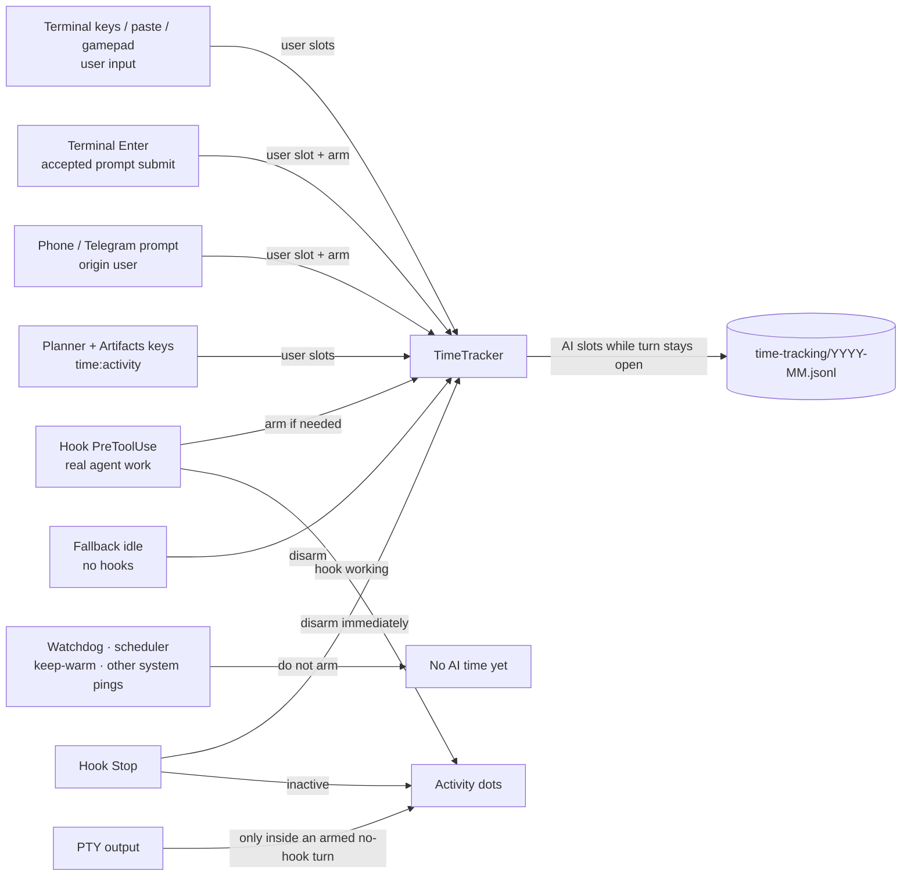
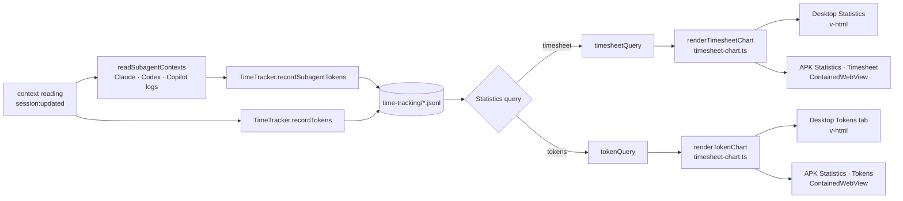
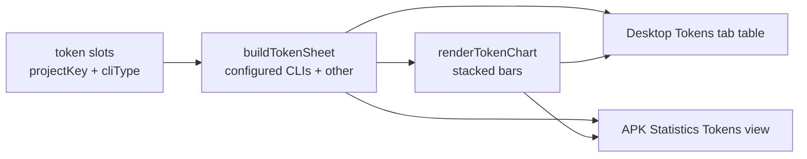

# Time Tracking

How long the user worked on each project, shown as a timesheet per folder.

## Why slots

Measuring the user's own time means guessing at the gaps between inputs. A fixed 5-minute grid makes the guess explicit and cheap. A slot counts if the user did anything in it, and idle slots count nothing. Several inputs inside one slot are still one slot.

## What counts

- **You** (`user` slots): input the user produced: keystrokes in the terminal, planner or artifacts, and on the phone any message or action that changes something. Read-only phone calls (`*_get`, `*_list`, `*_read_terminal`, …) do not count, and neither does reading a terminal.
- **Noise floor**: a project needs `SUBMIT_WEIGHT` (20) input in a slot to earn it. A keystroke weighs 1. A submit (Enter, a phone or Telegram message including speech-to-text, a phone edit) weighs the full 20, so one deliberate send always counts and a few stray keys never do.
- **What never counts:** Programmatic sends (background deliveries, AI-to-AI `session_send_text`, the scheduler, initial prompts) are `system` origin and never count.
- **One project per user slot.** If the user touches two projects in one slot, the one with more input wins, and a tie goes to the latest. Within that project, the folder with the most input gets the slot.
- **AI** (`ai` slots): a user-originated prompt arms a turn; real hook-reported work (`PreToolUse`) can arm one after a system prompt. The turn earns AI slots until a hook `Stop`, or until the fallback idle for a session without hooks. Watchdog, scheduler, keep-warm, and other system prompts do not arm time or turn a dot green. If a hook later proves real work, that work counts. TUI repaint output cannot reopen a turn or keep an idle session green. Agents genuinely run in parallel, so AI slots are per project, not exclusive.
- **Tokens** (`tokens` slots): every context-size reading a session reports (statusline, transcript, or API loop; see [terminal-architecture](terminal-architecture.md)) feeds a per-session ledger. A rise adds the growth. A drop (compact, `/clear`, quick compact) adds the new, smaller context, because the CLI re-read that much. So 199k → compact → 50k counts 249k. A session's first reading after Helm starts is only a baseline, so nothing is backfilled. Tokens are summed per project, CLI type, and directory per slot; the Tokens tab aggregates them per CLI. Every CLI type that reports its context size counts. Remote (peer) rows are skipped, since their own machine counts them.
- **Sub-agent tokens**: a sub-agent's work never shows in the main context, so its logs are read too (`subagent-usage.ts`). Claude writes one file per sub-agent in `<session>/subagents/`. A Codex sub-agent gets its own rollout file in the same folder, naming the parent in `parent_thread_id`. Copilot tags sub-agent `usage_record` lines in the parent's `events.jsonl` with an `agentId`. Each sub-agent is its own ledger stream with a zero baseline, so its whole context counts, then only its growth. The logs are re-read only when the main reading moves. The first read after Helm starts only primes the streams, so sub-agents counted by an earlier run are not counted twice.
- **Project** = the session's Helm project, or its working directory when it has none.

## Storage

Append-only JSONL, one file per local month under the app-data `time-tracking/` dir (config boundary). Each line is one closed slot `{start, kind, projectKey, projectName, dir}`, plus `tokens` and `cliType` on `kind: 'tokens'` (slots written before `cliType` existed have none). The open slot is written once it ends, or on shutdown. A corrupt line is skipped. A slot written at shutdown and reopened after a restart is deduplicated on read. For time the later record wins, because a slot is presence. Token records are deduplicated per project, CLI, and directory, then summed as disjoint partial counts. Appending survives crashes without a native DB dependency.

## Statistics pane

Dock pane **Statistics** (📊, shortcut `l`) has two tabs that share the period toggle and ◀ ▶ stepping. The **Timesheet** tab starts with totals for every project in the selected period, like the Android Statistics screen. Choose a project to drill into its folder rows; Back returns to the project list. The selected session never changes the timesheet scope. Project totals are ordered by user time, then AI time, then project name. The views are:

| View  | Columns |
|-------|---------|
| Hour  | the 24 hours of a day |
| Day   | the 7 days of a Monday week |
| Week  | the Monday weeks covering a month |
| Month | the 12 months of a year |

A chart sits above the table in both views. *You* and *AI* minutes are bars on the left axis, and tokens are a line on the right axis. CSS-only chips toggle each series, and the token axis hides with its series. The plot ends at the current column: periods that have not started yet are not drawn. The overview chart covers every project.

The chart is built once, in the main process, as self-contained SVG and CSS with no script. Both hosts draw the same markup, so they cannot drift apart. It is Helm's own markup with no AI-authored content, so the pane inlines it directly. Each folder cell shows *You* time, with an *AI* line and a *Tokens* line underneath when nonzero. The project overview shows each project's *You*, *AI*, combined and *Tokens* totals. The arrows page the selected period, and the range label jumps back to now. **CSV** is available in project detail and exports that project's current view (`period_start,project,directory,you_minutes,ai_minutes,tokens`).

### Tokens tab

Tokens per CLI per column: one row per configured CLI type, labelled by its display name, in config order and zero-filled, so an unused CLI still shows. Slots with no `cliType`, or from a CLI type no longer configured, share one trailing **other** row. Sub-agent tokens count toward the parent session's CLI. The chart above stacks one bar segment per CLI. `buildTokenSheet` and `renderTokenChart` back the desktop `time:tokens` channel and the Android Statistics Tokens view.

All arithmetic (`periodEdges`, `buildTimesheet`, `buildTokenSheet`, `summarizeProjects`, `timesheetToCsv`) lives in `src/session/time-tracker.ts`. The phone uses the reserved, read-only `__timesheet__` method with `view: "timesheet"` or `view: "tokens"`; omitting `view` keeps older phones on the existing timesheet shape. The mobile gate remains unchanged. Its handler routes to the same `timesheetQuery` and `tokenQuery` functions used by desktop IPC, so the ledger and chart are not duplicated. Timesheet responses include project totals, folder rows and chart markup; token responses include CLI rows, period totals and the shared token chart.

A saved dock layout from before a pane existed keeps its arrangement, and the new pane is offered as closed in the View menu (`dock-persistence.ts`, `adoptNewPanes`).
