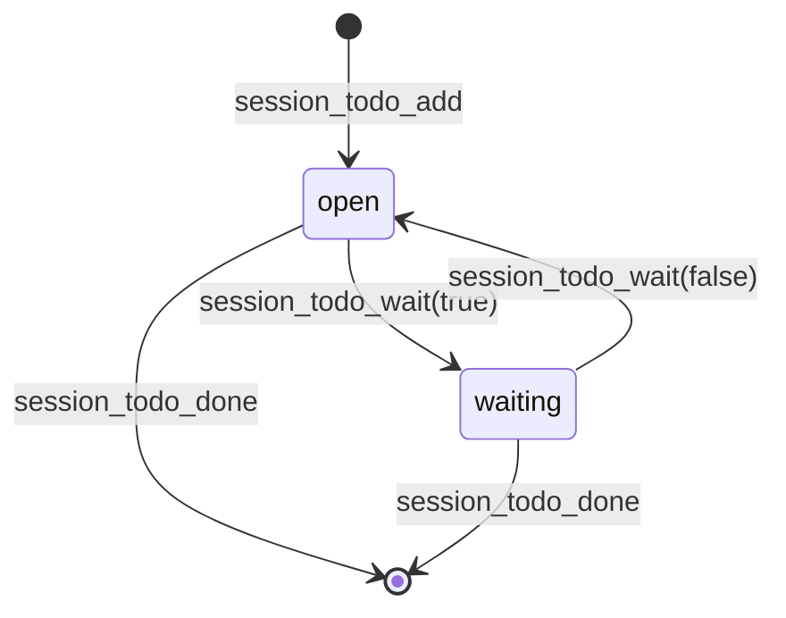
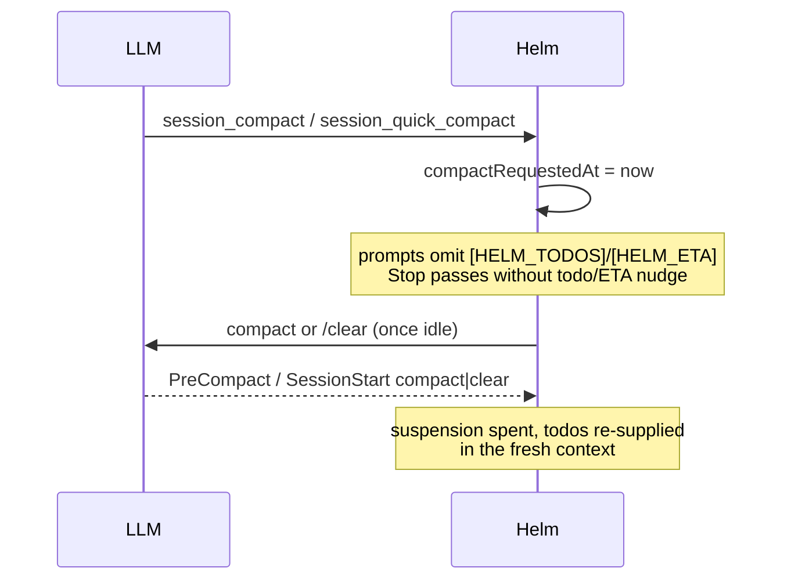

# Session Todos

Todos are a structured checklist for one Helm session, maintained by that session's LLM. The list holds only what is still to do: completing an item removes it, so the list never fills up with finished work that buries the next step. The desktop Todos dock pane is read-only; Ctrl+Shift+K focuses it; the sidebar shows an open-item count chip when the list is non-empty.

## MCP tools

Every `session_todo_*` call uses the authenticated caller's own session. These tools do not accept a target `sessionId`.

```text
session_todo_add(text="Add a regression test") -> { id, text, status, createdAt }
session_todo_done(id="...")                 -> the todo as it left the list (status done, doneAt)
session_todo_wait(id="...", waiting=true)   -> the todo, parked on the user (false resumes it)
session_todo_clear()                          -> number of removed items
session_todo_list()                           -> todos still to do, in order added
```

A todo that needs a user answer is parked with `session_todo_wait`. Without it, the Stop hook's once-per-turn open-todo nudge pushed the LLM to keep trying to finish work only the user could unblock, so it thrashed while the user was away. A waiting todo stays in the list, shows ⏳ in the pane, and is tagged `(waiting on user)` in `[HELM_TODOS]`, but never blocks a Stop. `session_todo_done` completes it directly.



`done` removes the item — use it for work that is finished or no longer wanted. `clear` empties the list. Lists saved by older versions may hold completed items; they are dropped on load. Keep entries short and actionable; use the Draft pane for unstructured working notes.

## Prompt context and lifetime

The UserPromptSubmit hook supplies a `[HELM_TODOS]` block with the open items and asks the LLM to keep the checklist and session mission current. Manifesto upkeep has its own, rarer reminder (see [artifact-viewer.md](artifact-viewer.md#keeping-the-manifesto-current)). The same context is supplied on SessionStart, including after CLI compaction. API sessions add it beside persistent manifesto context after `/clear`, `/compact`, and quick compact.

A session that asks to compact itself (`session_compact`, or `session_quick_compact` on a CLI) has its todo and ETA bookkeeping suspended until the compact lands. Otherwise the prompt's "add todos first" and the Stop nudge fight the compact request, and the LLM does bookkeeping instead of compacting.



The stamp is runtime-only. A failed send withdraws it, and it expires after 10 minutes if no compact arrives. Todos persist across the compact, so nothing is lost.

Lists are persisted per session. They survive restarts, compaction, and recycle-bin restores. A permanent session deletion, recycle-bin forget/expiry, or startup orphan cleanup removes its list.

The renderer reads the list through IPC and receives live changes from MCP calls. Only the session's LLM can add, complete, delete, or clear items; the desktop pane has no editing controls.
