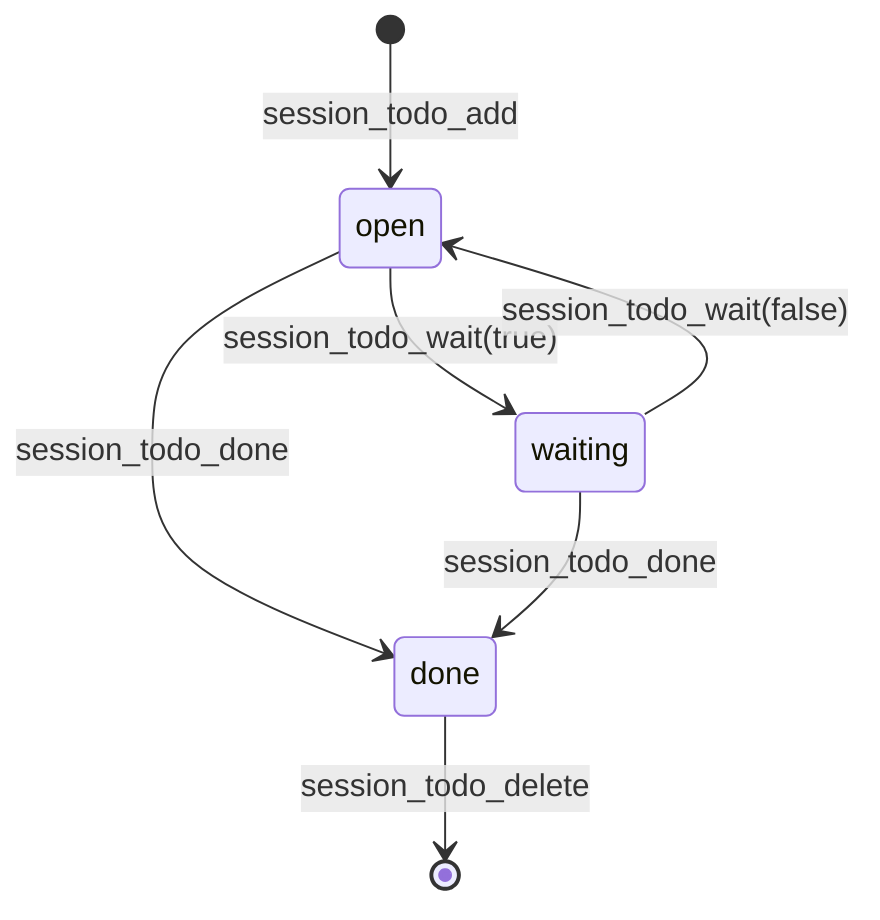

# Session Todos

Todos are a structured checklist for one Helm session, maintained by that session's LLM. The desktop Todos dock pane is read-only. It shows open items first and completed items struck through, with a Done filter chip (Any / Yes / No, the Plans filter-chip style, view-only); Ctrl+Shift+K focuses it; the sidebar shows a `done/total` chip when the list is non-empty.

## MCP tools

Every `session_todo_*` call uses the authenticated caller's own session. These tools do not accept a target `sessionId`.

```text
session_todo_add(text="Add a regression test") -> { id, text, status, createdAt }
session_todo_done(id="...")                 -> the completed todo
session_todo_wait(id="...", waiting=true)   -> the todo, parked on the user (false resumes it)
session_todo_delete(id="...")               -> true when deleted
session_todo_clear()                          -> number of removed items
session_todo_list()                           -> todos, open items first
```

A todo that needs a user answer is parked with `session_todo_wait`. Without it, the Stop hook's once-per-turn open-todo nudge pushed the LLM to keep trying to finish work only the user could unblock, so it thrashed while the user was away. A waiting todo stays in the list, shows ⏳ in the pane, and is tagged `(waiting on user)` in `[HELM_TODOS]`, but never blocks a Stop. `session_todo_done` completes it directly.



Only completed items can be deleted. Mark an open todo done first. `clear` removes both open and completed items. Keep entries short and actionable; use the Draft pane for unstructured working notes.

## Prompt context and lifetime

The UserPromptSubmit hook supplies a `[HELM_TODOS]` block with the open items and asks the LLM to keep the checklist and session mission current. The same context is supplied on SessionStart, including after CLI compaction. API sessions add it beside persistent manifesto context after `/clear`, `/compact`, and quick compact.

Lists are persisted per session. They survive restarts, compaction, and recycle-bin restores. A permanent session deletion, recycle-bin forget/expiry, or startup orphan cleanup removes its list.

The renderer reads the list through IPC and receives live changes from MCP calls. Only the session's LLM can add, complete, delete, or clear items; the desktop pane has no editing controls.
