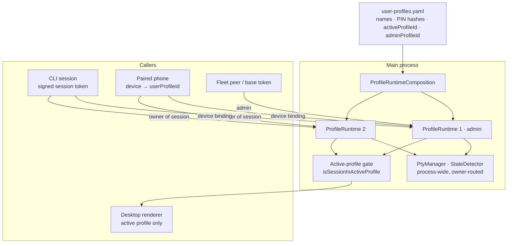
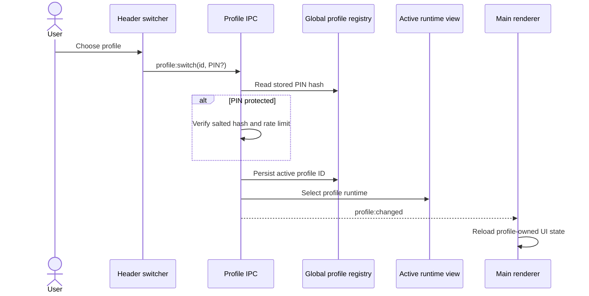

# User profiles

A user profile is a separate person's workspace inside one Helm install: their own sessions, projects, plans, memories, skills, CLI types and schedules. Profile 1 (`me`) is the original data, cannot be deleted, and is the default **admin**. A session spawn uses the runtime that owns the caller; it never falls back to profile 1.

**What this is not:** an OS sandbox. Profiles stop one person's Helm view, MCP calls and phone from reaching another's data through Helm. They do not stop a CLI process, which runs as the same Windows user, from reading any file that user can read. See [Limits](#limits).

## Data layout and migration

Writable data is split by who may see it:

| Scope | Lives in | Holds |
|-------|----------|-------|
| Per profile | `<appData>/Helm/profiles/<id>/config` | CLI types, skills, sessions, projects, plans, scheduler, recycle bin, artifacts, drafts, todos, memories, mess, time tracking, API sessions |
| Machine-wide | `<appData>/Helm/config` | `user-profiles.yaml`, settings, input config, gamepad bindings, peers + pins + secrets, mobile devices + secrets + chat journal, hooks, operator |

Stores take their paths explicitly (`getProfilePersistencePaths` / `getGlobalPersistencePaths`); nothing silently falls back to a process-wide profile path, which is what would let profile 2 write into profile 1's files.

On first launch after upgrade, the legacy single-user config tree is moved into profile 1 **before** any store seeds defaults, so no defaults are ever created in the old location. The move is journalled (`user-profile-migration.yaml`) and guarded by a lock, so an interrupted run resumes and two instances cannot both migrate. The machine-wide `restore-points/` directory is not moved, and creating a restore point while migration runs is refused.

## ProfileRuntime

A `ProfileRuntime` is the container of every per-profile manager (session, plan, memory, scheduler, recycle bin, …) built from that profile's paths. All runtimes stay live at once: switching the desktop changes which one the UI shows, not which ones run. That is why a background profile's agents keep working and a paired phone keeps talking to its own profile.

Process-wide pieces (`PtyManager`, `StateDetector`, notification and hook receivers) hold I/O, not profile data, and resolve the owner per session through `ProfileRuntimeRegistry.findSessionOwner`. The registry rejects duplicate session ids, so ownership is never ambiguous.

## MCP routing

Every MCP call is resolved to a runtime from the caller's identity, never from a global default:

| Caller | Resolved to |
|--------|-------------|
| CLI session (signed session bearer token) | the profile that owns that session |
| Phone (`mobile:<deviceId>` proxy identity) | the device's `userProfileId` |
| Fleet peer proxy identity | the admin profile |
| Base bearer token (no session) | the admin profile |
| Unknown session, device, or profile | refused (fail closed) |

The session id comes only from the signed token; a client cannot name another session to borrow its profile. Each runtime has its own MCP service set (plans, memory, drafts, uploads, session feed), so a tool call can only touch the caller's data.

## Admin role

`adminProfileId` in `user-profiles.yaml` names one profile (default 1). Admin-only surfaces: peers/fleet, mobile pairing and devices, the operator and voice, update install, machine-wide config, Helm restart, and viewing other profiles' details. They are enforced **in the main process** (`AdminGuard`, MCP dispatcher, mobile gate), not by hiding UI, because the renderer is not a trust boundary. The renderer only disables or hides controls (`AdminOnlyHint`) for non-admins. The admin profile cannot be deleted.

## Switching on the desktop

The main window header always shows the active profile. Open it with a click or gamepad Back, move through the list with the D-pad, and press A to select. B returns to the list or closes it. Keyboard arrows, Enter, Escape, and mouse clicks follow the same controls. A profile without a PIN switches directly. A profile with a PIN asks for it before changing the active desktop runtime.

PINs are optional and are stored as salted scrypt hashes. The raw PIN never enters the registry. Failed attempts receive a short per-profile backoff. Changing or clearing a PIN requires switching into that profile first.

After a successful switch, the main process updates the active profile ID and runtime view, then emits `profile:changed` to **every** window. Each window reloads: chat entries, notifications, flight badges and previews are renderer caches of the previous profile, and a reload is the one reset that cannot miss a store added later. Pop-out windows for the old profile's sessions are closed; the sessions keep running and return as normal rows on switch-back. Existing sessions, tools, projects, memories, skills, plans, and scheduled work stay in their owning profile.

### Active-profile event gating

Old-profile sessions keep running after a switch, so the main process must not push their data to a renderer that now shows someone else. One check, `ProfileRuntimeRegistry.isSessionInActiveProfile`, gates every main→renderer push of session-scoped data: terminal output and replay, chat entries, message-flight envelopes (and their acks), desktop notifications and flashes, and the admin operator's voice replies (admin-active only). Terminal IPC (input, resize, kill) applies the same check in the other direction.

Only the **desktop** is gated. A background profile's phone alerts still go to that profile's own bound devices.

## Paired device binding

Settings → Mobile assigns each paired phone or tablet to a profile. Devices default to profile 1 when first paired or migrated. Every mobile request reads the device's current `userProfileId` and routes to that profile's MCP services and session lookup. A missing or unknown profile binding is denied by the mobile gate. Move a device to another profile before deleting its current profile.

Profiles can be deleted only when inactive and when they have no live sessions, recoverable sessions, or paired devices. Deletion asks for confirmation before removing the profile record and local data directory.

## Spawn working directories

Desktop, MCP, scheduled, operator, restored, cloned, CLI-switched, API, ComfyUI and peer-created sessions must start inside a canonical or alternate folder registered in the owning profile's `ProjectStore`. The check resolves paths and existing symlinks/junctions, compares path boundaries, and treats Windows paths without case sensitivity. A rejected spawn reports the cwd and says it is outside that profile's project folders.

The row-less headless CLI used for auto-memory follows the same rule. It creates a per-run scratch folder beneath an existing project folder in its own profile and removes that folder after the run. If the profile has no existing project folder, the headless CLI does not start.

This rule limits the process's starting directory. Further folder limits come from the CLI's own sandbox or directory flags configured in that profile's CLI types. Helm does not add hook-policy confinement.

## Recycle bin restore

A restore always runs against the **active** profile's runtime, reuses the original session id, and re-checks the working directory against that profile's project folders. Another profile's bin entries are never visible or restorable, so a restore cannot resurrect a session into the wrong owner.

## Limits

- **Not an OS sandbox.** CLIs run as the same Windows user; a determined agent can read any file that user can. Confinement is of Helm's own data paths, MCP, IPC and phone routes.
- **Machine-wide stores are shared** and admin-managed: settings, input config and bindings, fleet peers and their secrets, mobile device store and pairing secrets, the mobile chat journal (one global sequence, filtered per profile at delivery), hooks, and the operator. A non-admin profile cannot read or change them through Helm, but they are not partitioned on disk.
- The localhost MCP listener and `ChatBroker` are shared coordinators; isolation comes from per-call caller resolution, not separate processes.
- Process restart and operator stay on the admin profile.
