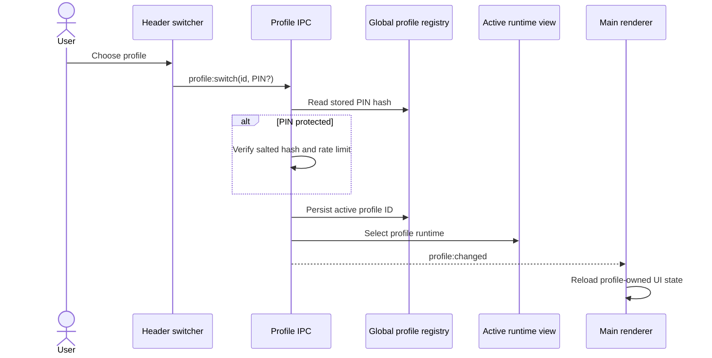

# User profiles

Each user profile owns its own `ProfileRuntime`, including its `ProjectStore`. A session spawn uses the runtime that owns the caller; it never falls back to profile 1. Profile 1 is the default `me` profile and cannot be deleted.

The global `user-profiles.yaml` registry stores profile names, salted PIN hashes, and the active desktop profile ID. Profile configuration and data live below that profile's data directory. All profile runtimes stay live while the desktop switches, so a paired phone or tablet keeps using its assigned profile.

## Switching on the desktop

The main window header always shows the active profile. Open it with a click or gamepad Back, move through the list with the D-pad, and press A to select. B returns to the list or closes it. Keyboard arrows, Enter, Escape, and mouse clicks follow the same controls. A profile without a PIN switches directly. A profile with a PIN asks for it before changing the active desktop runtime.

PINs are optional and are stored as salted scrypt hashes. The raw PIN never enters the registry. Failed attempts receive a short per-profile backoff. Changing or clearing a PIN requires switching into that profile first.

After a successful switch, the main process updates the active profile ID and runtime view, then emits `profile:changed`. The renderer reloads so Pinia stores and legacy module state are rebuilt from the selected profile. Existing sessions, tools, projects, memories, skills, plans, and scheduled work stay in their owning profile.

## Paired device binding

Settings → Mobile assigns each paired phone or tablet to a profile. Devices default to profile 1 when first paired or migrated. Every mobile request reads the device's current `userProfileId` and routes to that profile's MCP services and session lookup. A missing or unknown profile binding is denied by the mobile gate. Move a device to another profile before deleting its current profile.

Profiles can be deleted only when inactive and when they have no live sessions, recoverable sessions, or paired devices. Deletion asks for confirmation before removing the profile record and local data directory.

## Spawn working directories

Desktop, MCP, scheduled, operator, restored, cloned, CLI-switched, API, ComfyUI and peer-created sessions must start inside a canonical or alternate folder registered in the owning profile's `ProjectStore`. The check resolves paths and existing symlinks/junctions, compares path boundaries, and treats Windows paths without case sensitivity. A rejected spawn reports the cwd and says it is outside that profile's project folders.

The row-less headless CLI used for auto-memory follows the same rule. It creates a per-run scratch folder beneath an existing project folder in its own profile and removes that folder after the run. If the profile has no existing project folder, the headless CLI does not start.

This rule limits the process's starting directory. Further folder limits come from the CLI's own sandbox or directory flags configured in that profile's CLI types. Helm does not add hook-policy confinement.
